# gfx — architecture overview (the code as built)

This document describes the code as it is built, on 2026-10-31: the libraries, their modules, the
objects and how they relate, the paths a frame, an event and a physics step take, the threads, the physics
sandbox that puts every library in one window, and how everything is built and tested. The decisions behind
the platform, UI, physics and camera libraries and the sandbox, with the alternatives considered, are in
[platform-design.md](platform-design.md), [ui-design.md](ui-design.md), [physics-design.md](physics-design.md)
and [physics-sandbox-design.md](physics-sandbox-design.md) (the last three also record what each phase built);
the atlas file format is in [ui-atlas-format.md](ui-atlas-format.md); how to use the libraries is in the
[README](../README.md).

Diagrams are [Mermaid](https://mermaid.js.org/) (GitHub renders them). Arrows read "uses" or "depends
on" unless a diagram says otherwise.

## 1. Libraries, modules and dependencies

Ten libraries (and a build-time tool), each a CMake target whose public API is a set of C++ modules.
Backends are modules of a **private** file set: only the factory of their library imports them, so no
consumer can name a backend type or include a native header through gfx.

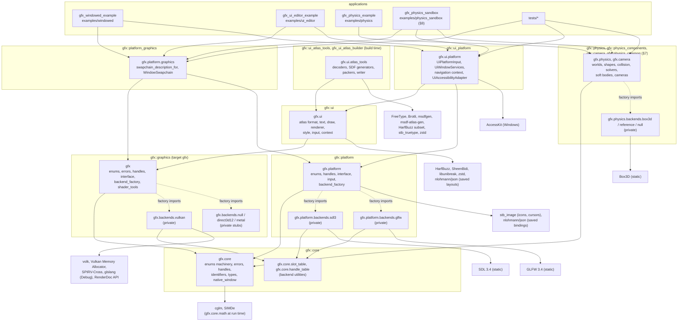

| Library | Source | Modules (public) | Namespace |
|---|---|---|---|
| core | `source/core/` | `gfx.core` = `gfx.core.enums`, `.errors`, `.handles`, `.types`, `.native_window`; plus `gfx.core.slot_table`, `gfx.core.handle_table` for backends | `gfx` |
| graphics | `source/graphics/` | `gfx` = `gfx.enums`, `gfx.errors`, `gfx.handles`, `gfx.interface` (one partition per object or concept), `gfx.backend_factory`, `gfx.shader_tools` | `gfx` |
| platform | `source/platform/` | `gfx.platform` = `gfx.platform.enums`, `.handles`, `.interface` (partitions), `.input` (partitions), `.backend_factory` | `gfx::platform` |
| bridge | `source/platform_graphics/` | `gfx.platform.graphics` (re-exports `gfx` and `gfx.platform`) | `gfx::platform` |
| ui | `source/ui/` | `gfx.ui` = `gfx.ui.enums`, `.handles`, `.errors`, `.atlas_format`, `.unicode`, `.text` (partitions), `.draw`, `.debug_overlay`, `.renderer`, `.style`, `.input`, `.context` (partitions) | `gfx::ui` |
| ui platform | `source/ui/platform/` | `gfx.ui.platform` (imports `gfx.ui` and `gfx.platform`) | `gfx::ui` |
| ui atlas tools | `source/ui/font/`, `source/ui/tools/` | `gfx.ui.atlas_tools` (partitions); the executable `gfx_ui_atlas_builder` that `gfx_add_ui_atlas()` runs | `gfx::ui` |
| physics common | `source/physics/` | `gfx.physics.enums`, `.handles`, `.errors`, `.primitives` (partitions) | `gfx::physics`, `gfx::camera` |
| camera | `source/physics/camera/` | `gfx.camera` = `gfx.camera.interface` (partitions), `gfx.camera.factory` | `gfx::camera` |
| physics components | `source/physics/` | `gfx.physics.shapes`, `.narrow_phase`, `.tasks`, `.spatial`, `.interface`, `.dynamics`, `.world` (each with partitions) | `gfx::physics` |
| physics | `source/physics/` | `gfx.physics` (re-exports the interface and the world framework), `gfx.physics.factory` | `gfx::physics` |

Rules every library follows:

- **One enumerations file per library** (`enums.cppm`): every enumeration and named constant, each with
  `EnumerationTraits` (names, bitmask or not) verified at compile time against the compiler's own
  spelling of each enumerator. `to_string`, `from_string`, `std::formatter` and the bitmask operators
  come from `gfx.core.enums`, which also holds what several libraries share — among them the keyboard,
  mouse and cursor enumerations (`Key`, `KeyCode`, `KeyModifier`, `MouseButton`, `MouseButtonMask`,
  `CursorShape`) of the platform and UI libraries (the platform library names them `gfx::platform::Key`
  too).
- **Typed handles** (`Handle<Tag>`, 32 bits: 24-bit slot, 8-bit generation) name objects in commands
  and events; only backends can create them (`HandleKey`, constructible by `HandleIssuer` only).
- **RAII**: objects are owned through `std::unique_ptr`; destruction releases (or defers the release
  until the GPU or the event pump no longer needs it).
- **Errors** name the backend, the operation, the problem and a suggestion; backends never degrade
  silently.
- **Native headers stay out of module purviews**: C headers in global module fragments, and headers
  that need `<windows.h>` or that conflict with `import std` in plain translation units behind small
  std-free headers (`vulkan_surface.hpp`, `glfw_native.hpp`, `json_reader.hpp`, `renderdoc_capture.hpp`,
  `freetype_library.hpp`, `accesskit_bridge.hpp`).

## 2. Core: what the libraries share

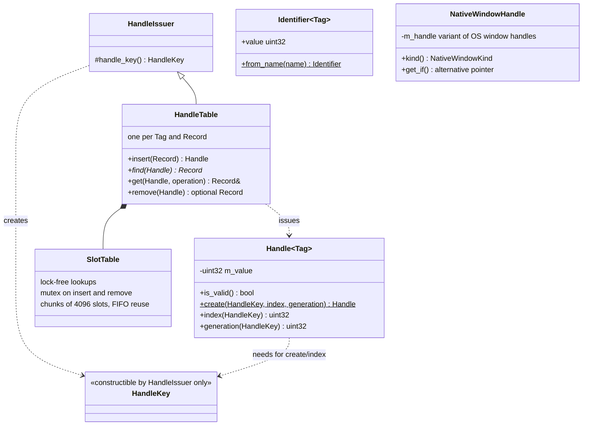

- **Handles vs identifiers**: a `Handle` is issued by a backend for an object that exists (a stale
  handle is detected by its generation); an `Identifier` is a compile-time hash of a name
  (`"jump"_action`, `"menu"_context`) chosen by the application.
- **`NativeWindowHandle`** carries operating-system handles only, as integers: the platform library
  produces it (`Window::native_handle()`), the graphics library consumes it (surfaces). Neither library
  depends on the other.
- **Handle tables** map a handle to a backend record (the native object and what commands need to know
  about it) with lock-free lookups, so any thread can resolve handles while recording.

Errors:


`BackendIdentity` is `{library, backend}`: messages start with `[gfx::VULKAN]` or `[gfx::platform::GLFW]`,
followed by the operation, the problem, a suggestion and the source location.

## 3. Graphics library

### 3.1 Object model


Objects are created by their parent and owned by the application (`std::unique_ptr`); commands and
descriptors name them by handle. Every interface operation is **pure virtual with a throwing default
definition**: a backend must override it, and may forward to the default, which throws a descriptive
`BackendCapabilityError`. The Null backend (an instance without devices) and the Direct3D 12 and
Metal stubs rely on that.

### 3.2 Recording

`Recorder<QueueType>` is a zero-cost typed wrapper over a `CommandBuffer`: methods are constrained by
the queue type, so `draw()` does not compile on a compute recorder. `begin_rendering()` returns a
`RenderingScope` (dynamic rendering, ended by its destructor); `begin_parallel_rendering()` returns a
`ParallelRenderingScope` whose parts are recorded on secondary command buffers by other threads
(`RenderingPartRecorder`) and executed in a fixed order. Barriers are synchronization2-style, derived
from `ResourceState` pairs (`image_barrier(image, before, after)`).

Per-frame helpers built on the interfaces (backend-independent): `FrameTimeline` (frame N signals N on a
timeline semaphore; the CPU runs at most `frames_in_flight` frames ahead), `FrameCommandPools` (one pool
per thread and frame in flight), `TransientBufferAllocator` (lock-free bump allocation in persistently
mapped memory), `Uploader` (staged uploads with barriers), `GpuProfiler` (timestamp scopes), and, in Debug
builds only (no-ops elsewhere), `FrameMetrics` (frame rate, CPU frame times over a period, the frame's
`CommandStatistics` summed over its command buffers, GPU timings, device memory) as lines of text. The
UI library's `gfx::ui::DebugOverlay` draws those lines (distance-field text over a translucent panel,
through `gfx::ui::UiRenderer`); the graphics library has no text of its own.

### 3.3 Vulkan backend

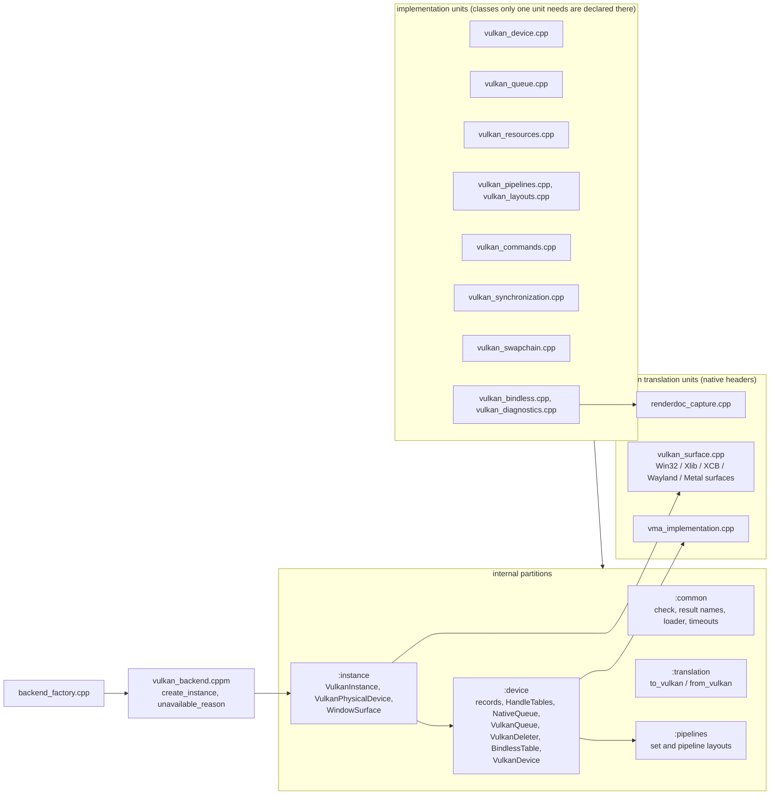

- **Records**: each handle table maps a handle to a record holding the native object and what commands
  need (an image's format, aspects, extent; a pipeline's atomic `VkPipeline` for asynchronous builds and
  hot reload). Records exist because commands receive only handles, which by design carry no pointer;
  the objects themselves belong to the application.
- **Queues**: each gfx queue maps to a `NativeQueue` (several gfx queues may share one when a family has
  fewer queues than requested). A native queue has a mutex and a **progress timeline**: every submission
  signals it, and the deleter runs a deferred destruction once every native queue has passed the value
  it had when the destruction was requested. Submissions that would deadlock a shared hardware queue
  (waiting for a value only a later submission to it signals) are refused.
- **Bindless table**: one update-after-bind descriptor set per device; resources register themselves
  when created; every command buffer binds it once.
- **Presentation**: surfaces are created from the `NativeWindowHandle` in `vulkan_surface.cpp`; a
  swapchain's images are registered in the image tables (not owned, not bindless) so barriers and
  rendering use their handles; a window without area has no native swapchain.

### 3.4 Shaders

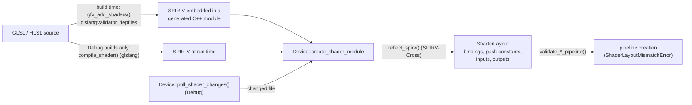

## 4. Platform library

### 4.1 Object model


Monitors, gamepads, joysticks and touch devices are **handles** queried through the platform (they come
and go with the hardware); windows and cursors are objects the application owns. Destroying a window
closes it; its native resources are released at the next pump, never inside a backend callback.

### 4.2 Events

`Event` is a **value type of at most 64 bytes, trivially copyable**: an `EventType`, the window it concerns,
a timestamp, and a `std::variant` of payload structs (`WindowEvent`, `KeyboardEvent`, `MouseButtonEvent`,
`GamepadAxisEvent`, ...). Each payload lists the event types it serves (`TYPES`), so
`Event::make<EventType::KEY_DOWN>(...)` only accepts the matching payload, and `get_if` / `as` / `visit`
read it. Text (typed text, dropped file paths, IME compositions) lives in the span's text buffer, not in
the event. The `EventQueue` behind each pump is reused: **no allocation while pumping** in steady state.

### 4.3 The pump

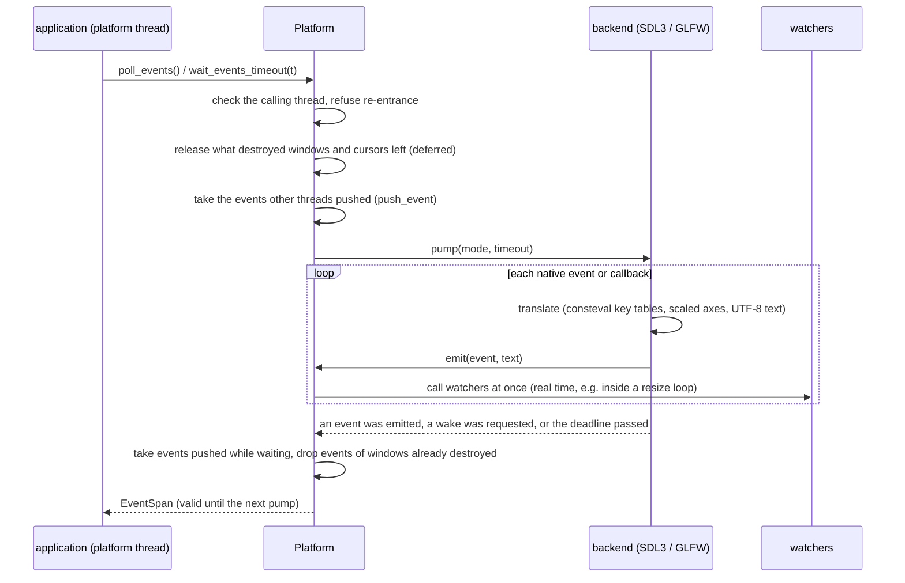

**SDL3 backend**: an SDL event watch translates the events SDL raises while it pumps (so watchers run in
real time, also inside Windows' modal resize loop); keys come as USB HID scancodes, as gfx's `Key`;
gamepads (rumble, LEDs, touchpads) through SDL's gamepad API; sizes are events only when they changed.
**GLFW backend**: callbacks deliver events during the pump and queue those GLFW raises outside it; keys
go through a `consteval` table from `GLFW_KEY_*` to `Key`, checked by `static_assert`s; gamepads and
joysticks are polled each pump and reported as differences. What a backend lacks (GLFW: touch, IME
composition, rumble, ...) throws `BackendCapabilityError`. One backend is active at a time.

### 4.4 Input: from events to actions

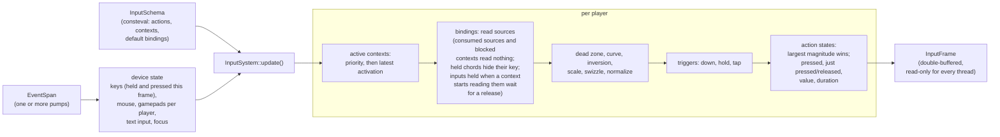

- The **schema** is built by `consteval` functions: actions (`BUTTON`, `AXIS_1D`, `AXIS_2D`), contexts
  (priority, consumes input, blocks lower contexts) and bindings. A wrong schema is a compile error whose
  message names the problem (`input_schema_error_two_actions_have_the_same_name()`).
- **Contexts** are activated per player and stay active while the returned `ContextActivation` lives.
- **Held inputs** (`ContextDescription::ignore_held_inputs`, on by default): each binding remembers which of
  its digital sources it could read in the previous frame; a source it starts to read (its context was
  activated, a context above stopped blocking or consuming it, text input ended) while held since an
  earlier frame reads as released until it is released. Presses that begin in the frame count; sticks,
  triggers and mouse motion are never ignored.
- **Players** own contexts, a gamepad (assigned automatically on first use or explicitly) and their action
  states; the keyboard and mouse belong to one player.
- **Rebinding**: `rebind`, `add_binding`, `remove_binding`, `capture_next_binding` (the captured press
  does not reach the actions), `find_bindings_using`; `save_bindings` / `load_bindings` write and read
  JSON naming keys and buttons (only bindings that differ from the defaults; loading is all or nothing).

### 4.5 Threads

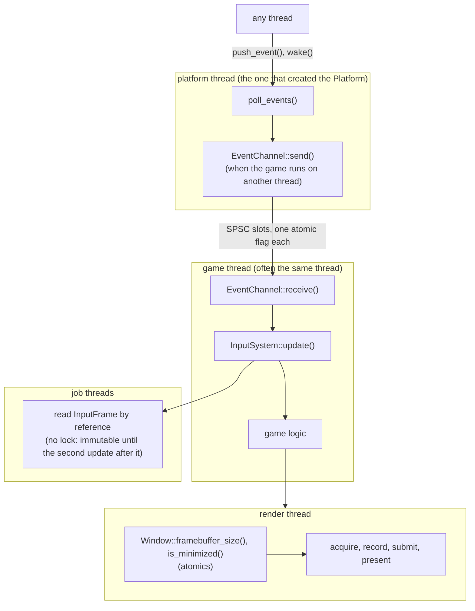

This is the arrangement of commercial engines (Unreal, Unity, Godot, SDL's rules): the operating system
requires window events on one thread; input is evaluated once per game frame into an immutable frame
that any number of job threads read; the render thread never touches the platform or the input system.

## 5. Bridge: presenting to a window

`gfx.platform.graphics` holds the only code that knows both libraries:
`swapchain_description_for(window)` (native handle and framebuffer size), the recreation rules
(`requires_swapchain_recreation(event or status)`), and `WindowSwapchain`.

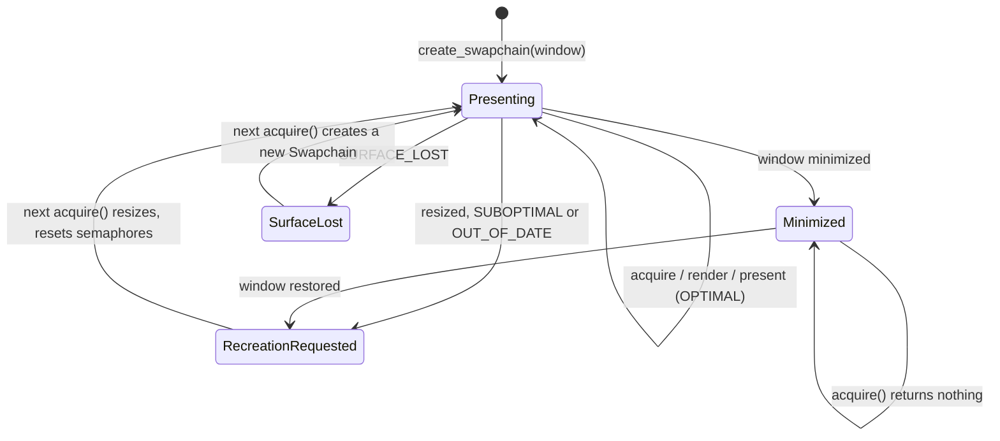

Semaphores: one **acquisition semaphore** per image plus one. Each acquisition takes a free one; when an
image comes back, the semaphore of its previous acquisition is free again (the image's presentation, and
therefore the rendering that waited on that semaphore, is over). One **rendering semaphore** per image:
the presentation engine may still hold the previous frame's semaphore, so reusing one per frame in flight
would be invalid.

One frame of the windowed example:

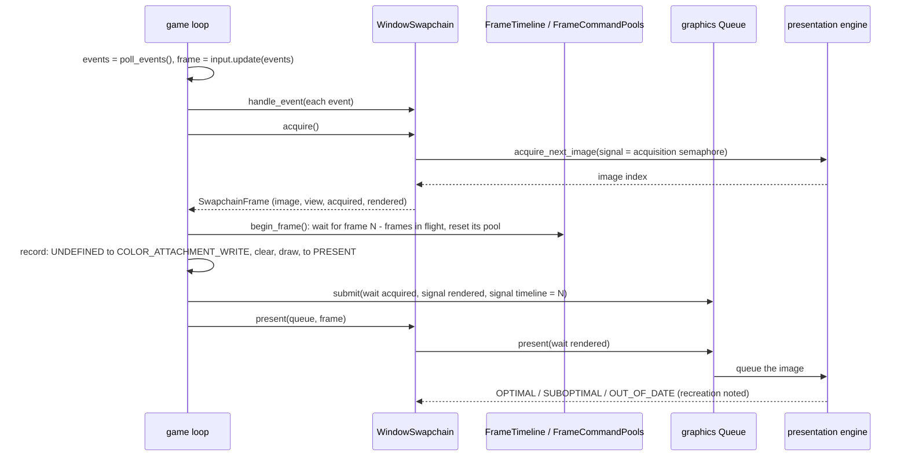

## 6. UI library

An immediate-mode UI over retained state (Dear ImGui's model: no widget objects, no callbacks) whose every
glyph is drawn from a signed distance field. Text, drawing and rendering are usable on their own; the
context adds windows, widgets, tables, docking, navigation, shortcuts and an accessibility tree.

### 6.1 Modules

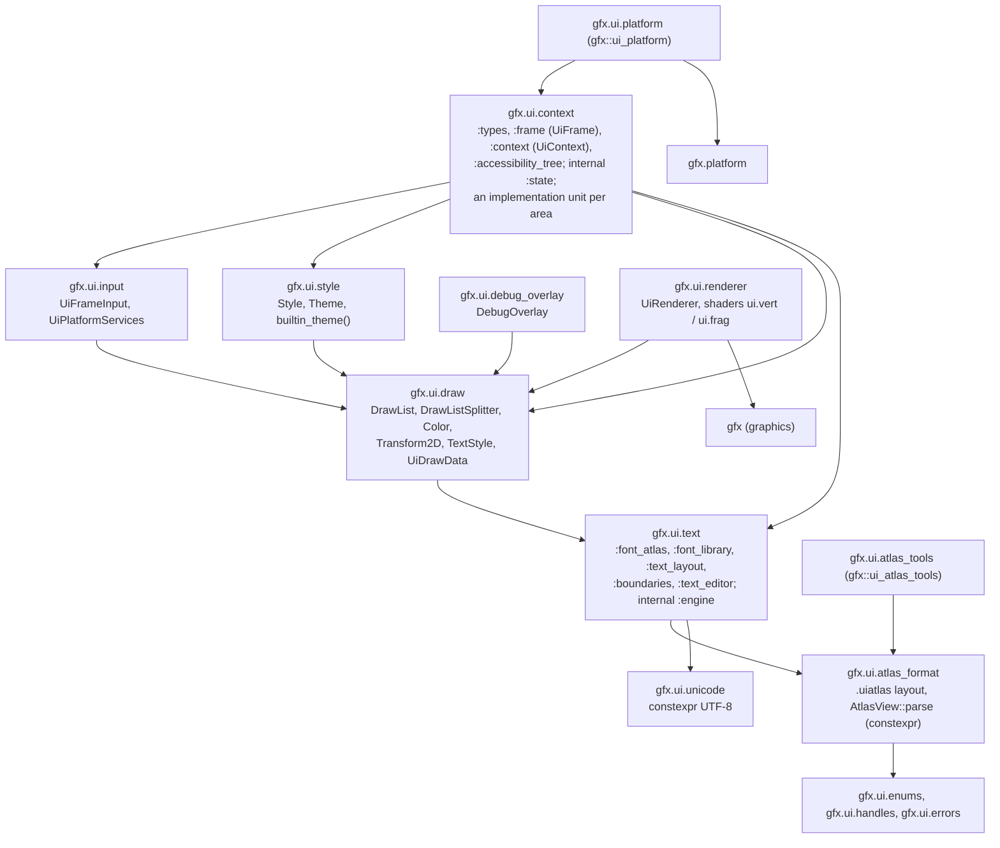

The context never imports the renderer or the graphics library: it produces `UiDrawData` (lists of vertices,
indices and commands, in pixels), which `UiRenderer` or any other renderer draws. Errors are the core's
(`UiCapabilityError` is `BackendCapabilityError`, messages start with `[gfx::ui::FONT]`, `[gfx::ui::WIDGETS]`, ...),
and every enumeration and constant of the library is in `source/ui/enums.cppm`.

### 6.2 Fonts: from a font file to a glyph on screen

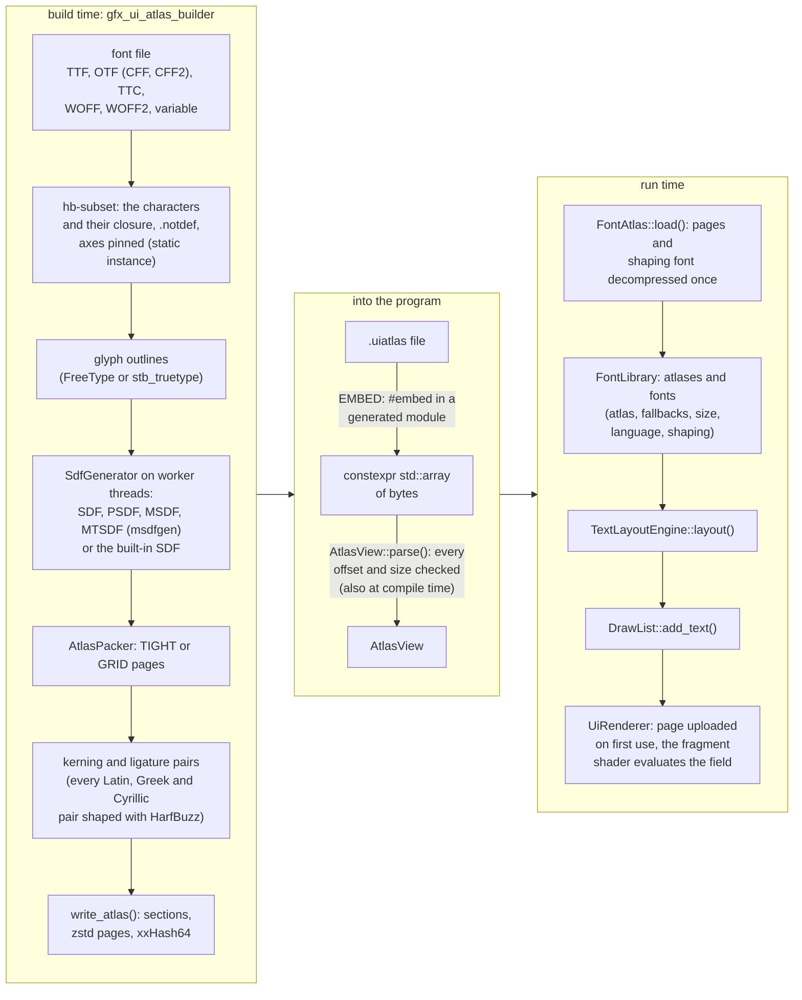

No glyph is rasterized at run time: an atlas is a few sections (descriptor, face metrics, glyphs, character
map, kerning, ligatures, the subset font HarfBuzz shapes with, and the pixel pages) read in place. The same
font and description give the same bytes on every machine, which a test checks.

### 6.3 Text layout

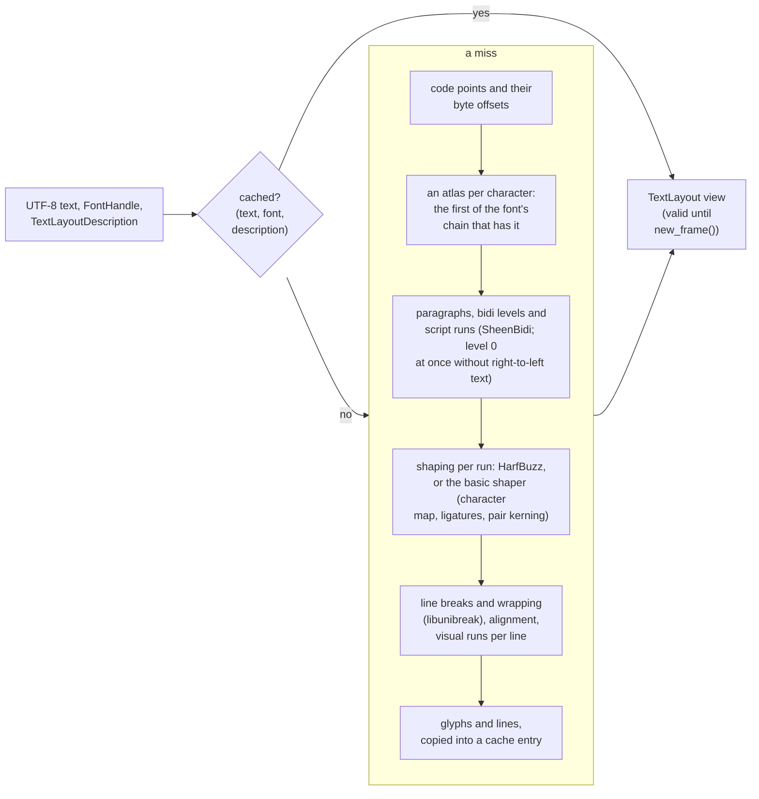

The cache keeps the layouts of the frames before, so that a UI whose texts do not change lays nothing out;
a text that changes every frame (a counter, a frame time) takes the storage of a layout no longer used, so
that it allocates nothing either once texts of its length have been seen:

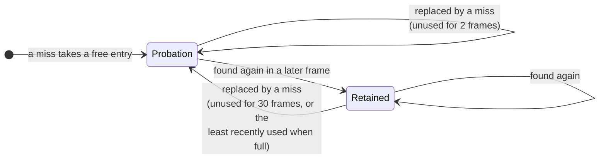

A miss is laid out in scratch storage first; then, of the oldest 16 replaceable entries of each list, the one
whose storage holds the layout with the least to spare is replaced (storage grows only in powers of two). When
every entry is in use this frame, the layout goes to an overflow entry and is reported (`CACHE_FULL`).
`TextBoundaries` and `TextEditor` (graphemes, words, editing with undo) serve the text fields.

### 6.4 Drawing and rendering

`DrawList` records rectangles (rounded, bordered, gradients), circles, lines, polylines, polygons, images and
laid-out text under transform and clip stacks, as 48-byte vertices, 32-bit indices and commands; a command
changes only when the clip rectangle or the texture changes (shapes and glyphs share commands: the shader mode
is per vertex). `UiRenderer` draws `UiDrawData` with one graphics pipeline on the bindless layout: `prepare()`
uploads the atlas pages the data samples for the first time (before the pass), `record()` writes the frame's
vertices and indices into its region of one persistently mapped buffer (a region per frame in flight), and per
command sets the scissor and push constants (scale, translation, the buffer's bindless index, the texture and
sampler indices) and draws; the vertex shader pulls its vertex from the buffer. Shapes are signed distances
(edges one pixel wide at any scale), glyphs are their atlas's field (outline, shadow and glow included).

### 6.5 The context and a frame

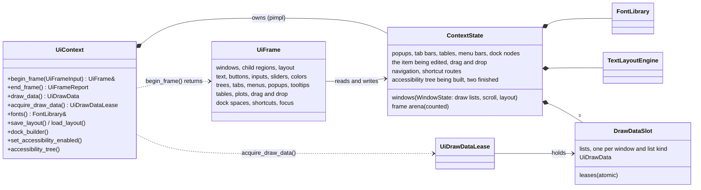

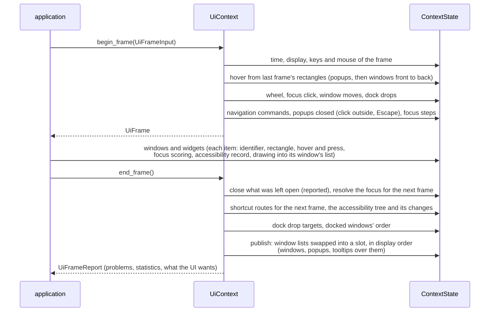

- **Nothing throws in a frame**: misuse is reported in the frame's report. After its first frames a frame
  allocates nothing: containers keep their storage, the frame's scratch memory is an arena whose upstream
  counts allocations, identifier maps grow only past half load.
- **Windows** are found by their identifier (the name hashed with the identifier stack); their first frame is
  measured, not drawn. Hover, clicks and the wheel use the rectangles of the frame before.
- **Docking**: dock nodes (in slots with generations) are splits (side by side or stacked, with a ratio) or
  leaves (windows in tab order, the selected one, central). A dock space roots a tree in a window or over the
  display; a floating tree has a host window. Docked windows take their node's area, and their tabs are tab
  bars drawn by the tree's layout; drag a window over a node to dock it (targets and a preview in an overlay
  list), drag its tab away to tear it off. `save_layout()` and `load_layout()` write and read JSON (windows,
  trees, tables' columns), all or nothing.

### 6.6 Navigation, shortcuts and accessibility

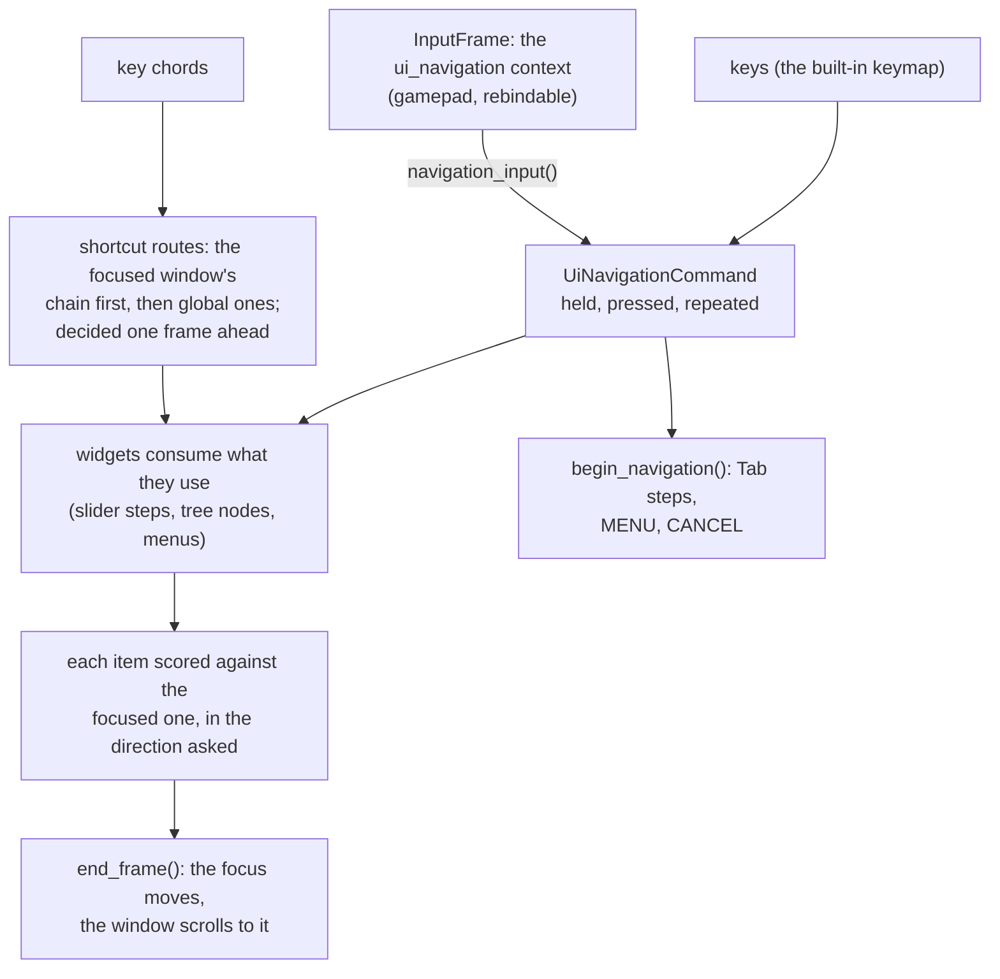

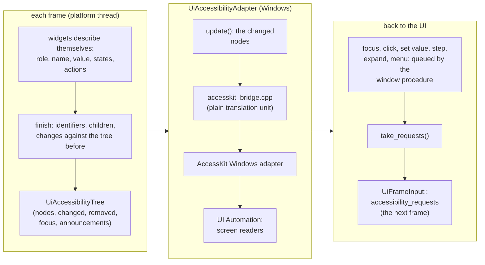

A node's identifier is its window's identifier and its item's (`window << 32 | item`); the adapter answers
`WM_GETOBJECT` through a window subclass and sends AccessKit only the changed nodes.

### 6.7 Threads: a render thread

The context runs on one thread; `end_frame()` publishes into one of three slots, in turn (the slot published
longest ago, else the other one not leased), and a `UiDrawDataLease` keeps a slot's lists untouched while
another thread reads them. A window's lists trade their storage with the same lists of each slot, so what each
storage holds does not depend on the threads' timing. The editor example:

```mermaid
sequenceDiagram
    participant M as main thread (platform, input, UI)
    participant C as UiContext
    participant B as mailbox (one packet)
    participant R as render thread
    M->>M: poll_events(), InputSystem::update()
    M->>C: begin_frame(), the editor's windows, end_frame()
    C->>C: publish into the next free slot
    M->>C: acquire_draw_data()
    C-->>M: lease
    M->>B: put(lease and a snapshot of the scene)<br/>(waits while the packet before is there)
    B->>R: take()
    R->>R: WindowSwapchain::acquire(), FrameTimeline::begin_frame()
    R->>R: clear, the scene's squares
    R->>R: UiRenderer begin_frame, prepare, record (geometry copied out)
    R->>R: submit, present
    R->>C: the packet goes: lease released
```

The main thread builds frame N + 1 while the render thread draws frame N. Only the render thread touches the
swapchain; the main thread tells it to recreate (`requires_swapchain_recreation()` on the window's events,
`WindowSwapchain::request_recreation()` on the render thread).

## 7. Physics and camera libraries

The physics library (`import gfx.physics;`) and the camera library (`import gfx.camera;`) know nothing of the
graphics, platform or UI libraries: their link closure is checked at configure time (`gfx_require_decoupled()`) and
their sources' imports by a CTest scan. The decisions behind them, the phases and what each phase built are in
[physics-design.md](physics-design.md).

### 7.1 Targets and modules

```mermaid
flowchart TB
    subgraph physics_lib["gfx::physics"]
        direction TB
        umbrella["gfx.physics<br/>(the interface, the framework, the factory)"]
        factory["gfx.physics.factory<br/>create_physics_world(), physics_backend_availability()"]
        box3d["gfx.physics.backends.box3d<br/>(private)"]
        reference["gfx.physics.backends.reference<br/>(private)"]
        null_backend["gfx.physics.backends.null<br/>(private)"]
    end
    subgraph components_lib["gfx::physics_components"]
        direction TB
        world["gfx.physics.world<br/>SteppedWorld, SteppedWorldBackend,<br/>edits, snapshots, the abstraction's queries"]
        dynamics["gfx.physics.dynamics<br/>integrators, presets, XPBD soft-body solver,<br/>sequential-impulse solver, joint rows"]
        interface["gfx.physics.interface<br/>PhysicsWorld, objects, descriptions,<br/>pipeline components"]
        spatial["gfx.physics.spatial<br/>BVH, loose octree and quadtree, BSP, grid,<br/>sweep and prune, SpatialBroadPhase"]
        narrow["gfx.physics.narrow_phase<br/>GJK, EPA, separating axes, clipping,<br/>manifolds, shape queries"]
        shapes["gfx.physics.shapes<br/>convex shapes, hulls, meshes,<br/>height fields, compounds, mass"]
        tasks["gfx.physics.tasks<br/>TaskScheduler, ThreadTaskScheduler"]
        debug_draw["gfx.physics.debug_draw<br/>shapes as meshes, debug lines"]
    end
    subgraph camera_lib["gfx::camera"]
        direction TB
        camera["gfx.camera<br/>projections, Camera, controllers, factory"]
        standard["gfx.camera.backends.standard<br/>(private)"]
    end
    subgraph common_lib["gfx::physics_common"]
        common["gfx.physics.enums, .handles, .errors,<br/>gfx.physics.primitives<br/>(planes, boxes, rays, hulls, frustums, SIMD culling)"]
    end
    core["gfx::core<br/>gfx.core, gfx.core.math<br/>(constexpr; cglm and SIMDe at run time)"]
    umbrella --> world
    umbrella --> debug_draw
    umbrella --> factory
    factory -.->|imports| box3d
    factory -.->|imports| reference
    factory -.->|imports| null_backend
    box3d --> third_box3d["Box3D (static)"]
    physics_lib --> components_lib
    world --> dynamics
    dynamics --> interface
    interface --> spatial
    interface --> narrow
    narrow --> shapes
    debug_draw --> narrow
    spatial --> tasks
    components_lib --> common_lib
    camera -.->|factory imports| standard
    camera_lib --> common_lib
    common_lib --> core
```

- **`gfx::physics_common`**: one enumerations file for physics and camera, 17 handle kinds (core's `Handle<Tag>`,
  explicitly instantiated once: a toolchain workaround, §9), `PhysicsError` (capability gaps throw core's `BackendCapabilityError`),
  `QueryResult<T> = std::expected<T, QueryFailure>`, and primitives whose tests are constexpr, with SIMD batches
  (frustum culling of boxes and spheres) giving the same bits as the scalar code.
- **`gfx::camera`** depends on the primitives only; **`gfx::physics_components`** never on the camera.
- **`gfx::physics`** holds the backends behind the factory: Box3D (when `GFX_PHYSICS_BACKEND_BOX3D`), the reference
  backend (always), the null one, and a custom one named by `GFX_PHYSICS_CUSTOM_BACKEND_TARGET`.

### 7.2 Worlds, objects, backends and components

```mermaid
classDiagram
    direction TB
    class PhysicsWorld {
        <<interface>>
        +create_rigid_body() RigidBody
        +create_joint() Joint
        +create_constraint() Constraint
        +create_trigger() Trigger
        +create_soft_body() SoftBody
        +step(seconds)
        +begin_step(seconds)
        +wait_step()
        +events() PhysicsEvents
        +ray_cast() QueryResult
        +shape_cast() QueryResult
        +overlap() QueryResult
        +closest_point() QueryResult
        +broad_phase() BroadPhase
        +replace_broad_phase(BroadPhase)
    }
    class RigidBody {
        +add_collider() Collider
        +state() RigidBodyState
        +set_pose(Transform)
        +apply_linear_impulse(Vector3)
        +move_kinematic(Transform, seconds)
    }
    class SteppedWorld {
        <<final>>
        records edits, publishes snapshots,
        runs asynchronous steps, answers queries
    }
    class SteppedWorldBackend {
        <<interface>>
        +check(edit, RecordedWorld)
        +apply(edits, pending)
        +simulate(seconds, pending)
        +simulates_soft_bodies() bool
        +apply_soft_body_corrections()
        +ray_cast() optional
    }
    class Box3dBackend {
        Box3D world, bodies, shapes, joints
    }
    class ReferenceBackend {
        records are the truth
    }
    class NullWorld {
        throws BackendCapabilityError
    }
    class BroadPhase {
        <<interface>>
    }
    class NarrowPhase {
        <<interface>>
    }
    class Solver {
        <<interface>>
        +solve(SolverStep)
    }
    class Integrator {
        <<interface>>
        +predict(IntegrationState, seconds)
    }
    PhysicsWorld <|.. SteppedWorld
    PhysicsWorld <|.. NullWorld
    PhysicsWorld ..> RigidBody : creates
    RigidBody ..> Collider : creates
    PhysicsWorld ..> Joint : creates
    PhysicsWorld ..> Constraint : creates
    PhysicsWorld ..> Trigger : creates
    PhysicsWorld ..> SoftBody : creates
    SteppedWorld *-- SteppedWorldBackend
    SteppedWorldBackend <|.. Box3dBackend
    SteppedWorldBackend <|.. ReferenceBackend
    ReferenceBackend *-- BroadPhase
    ReferenceBackend *-- NarrowPhase
    ReferenceBackend *-- Solver
    ReferenceBackend *-- Integrator
    BroadPhase <|.. SpatialBroadPhaseComponent
    NarrowPhase <|.. GjkNarrowPhase
    Solver <|.. SequentialImpulseSolver
    Integrator <|.. SemiImplicitEulerIntegrator
```

- **Objects** are owned by the application (`std::unique_ptr`) and name themselves by handles; destroying one records
  its destruction (a body's colliders, joints, constraints and pins go with it).
- **`SteppedWorld`** is the framework every simulating backend runs in. A backend implements three operations — check
  an edit when it is recorded (capability errors at once, not at the next step), apply a step's edits, simulate — and,
  if it has them, its own queries; everything else (handles, edits, snapshots, the thread, the reader handshake, the
  abstraction's queries, soft bodies) is the framework's.
- **Components** are the reference backend's parts, each replaceable between steps through `replace_*()`:
  `SpatialBroadPhaseComponent<Structure>` over any spatial structure (BVH, loose octree or quadtree, BSP, uniform grid,
  sweep and prune), `GjkNarrowPhase`, `SequentialImpulseSolver`, and the integrators (semi-implicit Euler, Verlet,
  Runge–Kutta 4; XPBD for soft bodies). Box3D refuses replacement (`CUSTOM_BROAD_PHASE` …).

### 7.3 A step

```mermaid
sequenceDiagram
    participant A as application thread
    participant W as SteppedWorld
    participant T as world thread
    participant B as backend
    participant X as XPBD soft-body solver
    participant Q as query threads
    A->>W: create, set, destroy (handles at once)
    W->>W: check, record WorldEdit (mutex)
    A->>W: begin_step(seconds)
    W->>W: stepping flag, wait for readers to leave
    W->>T: the step
    T->>T: recorded edits into the pending records, masses
    T->>B: apply(edits, pending)
    T->>B: simulate(seconds, pending)
    T->>X: soft bodies (backends without their own)
    X->>B: apply_soft_body_corrections()
    T->>T: boxes, statistics
    Q->>W: ray_cast()
    W-->>Q: STEP_IN_PROGRESS (no wait)
    A->>W: wait_step()
    W->>W: publish the pending snapshot, free the destroyed slots, update the query tree
    A->>W: getters, events(), queries
```

- **Edits apply at the start of the next step, in the order recorded**, whenever they are made: a replay of the same
  edits gives the same world. Getters read the published snapshot of the last completed step (records copied only
  when their configuration changed).
- **The reader handshake**: a query increments the readers then reads the stepping flag; `begin_step()` sets the flag
  then waits for the readers to reach zero (both pairs sequentially consistent). A query never sees a half-applied step.
- **Queries** through the abstraction (`QueryEngine::ABSTRACTION`): a BVH over the published colliders' boxes, then the
  narrow phase's shape queries (GJK ray casts, conservative-advancement shape casts, overlaps, closest points), ties to
  the smaller handle, results into the caller's spans. Through the backend (`BACKEND`): Box3D's own; a backend without
  queries returns none and the abstraction answers.

### 7.4 The reference backend's step

```mermaid
flowchart LR
    subgraph collide["collide (once per step)"]
        direction TB
        wake["edits woke bodies; impulses applied"] --> boxes["collider boxes into the broad phase<br/>(continuous bodies' stretched by their motion)"]
        boxes --> pairs["pairs: different bodies, one dynamic,<br/>not joined, not both at rest"]
        pairs --> manifolds["narrow phase in chunks of 32 pairs<br/>on the scheduler, merged in order"]
        manifolds --> cache["manifold cache: returning points<br/>get last step's impulses"]
    end
    subgraph islands_group["islands"]
        direction TB
        islands["union-find over contacts, joints, constraints"] --> wake_islands["an island wakes as a whole"]
    end
    subgraph sub_steps["each sub-step"]
        direction TB
        integrate["forces and gravity through the integrator"] --> move_points["contact points moved with their bodies"]
        move_points --> solve["Solver::solve: warm start, velocity iterations<br/>(joint rows, then contacts with friction),<br/>restitution, positions, non-linear Gauss–Seidel"]
    end
    subgraph results["results"]
        direction TB
        records["poses and velocities into the records,<br/>impulses into the cache"] --> joints["joints' forces averaged over the sub-steps,<br/>breaking"]
        joints --> sleep["islands asleep after the sleep time"]
        sleep --> events["contact BEGIN, HIT, END; trigger ENTER, STAY, EXIT"]
    end
    collide --> islands_group --> sub_steps --> results
```

The number of sub-steps is `SolverDescription::sub_steps` (4 by default). The solver colors joints and contacts by the dynamic bodies they move and runs a color of 128 or more on the task
scheduler, so any thread count gives the same bits. Runs of equality rows (a point, an orientation: up to six) are solved
as one system (Cholesky); joint rows have exact Jacobians (`joint_rows()`, public, checked against measured rates).

### 7.5 Collision: shapes, structures, pairs, manifolds

```mermaid
flowchart TB
    subgraph broad["broad phase"]
        direction TB
        structure["SpatialStructureConcept<br/>BVH, LooseTree (octree, quadtree), Bsp,<br/>UniformGrid, SweepAndPrune"] --> spatial_broad["SpatialBroadPhase#lt;Structure#gt;<br/>fat boxes, CollisionFilter, sorted pairs<br/>(same pairs for any thread count)"]
    end
    subgraph narrow_group["narrow phase"]
        direction TB
        dispatch["collide(ShapeInstance, ShapeInstance):<br/>compile-time dispatch per shape pair"] --> analytic["analytic: spheres, capsules, boxes;<br/>separating axes box–box, triangle–triangle"]
        dispatch --> gjk["GJK: distance and closest features"]
        gjk -->|overlapping| epa["EPA: penetration depth and normal"]
        gjk --> clipping["face clipping: up to 4 points"]
        epa --> clipping
        dispatch --> meshes["compounds and meshes: their leaves<br/>(one-sided triangles, active edges)"]
        meshes --> dispatch
    end
    spatial_broad -->|pairs| dispatch
    clipping --> manifold["ContactManifold<br/>normal from first to second, features"]
    analytic --> manifold
    manifold --> cache2["ManifoldCache<br/>features match last step's points"]
```

Shapes are a `std::variant` (sphere, capsule, cylinder, cone, box, hull, triangle, triangle mesh, height field,
compound); `make_shape()` makes one that colliders share. Hulls can be built at compile time (`convex_hull<V, F, I>()`:
quickhull in a constant expression into a `FixedHull`); meshes and compounds keep a static BVH of their parts. GJK and
EPA are robust to slivers, origins on a boundary and nearly coplanar points (found by random sweeps); a sliver is a
tetrahedron whose volume is within the rounding error of its corners, so a shallow overlap of a large shape (a body
resting on a 100 m floor) is no sliver. Every structure shows its nodes or cells (`nodes()`: `SpatialNode` boxes with
their depth and proxies), and a broad phase component lists them (`BroadPhase::structure_nodes()`): what the
sandbox's broad phase view draws (§8).

### 7.6 Soft bodies and their coupling with rigid bodies

```mermaid
flowchart LR
    rigid["the backend's step moves the rigid bodies<br/>(start pose to end pose); then<br/>XpbdSoftBodySolver, per soft body"] --> xpbd
    subgraph xpbd["XPBD, each sub-step"]
        direction TB
        predict["predict: velocities, gravity"] --> constraints["constraint colors: stretch, shear, bending,<br/>dihedral, volume (512 or more: on the scheduler)"]
        constraints --> tethers["tethers, pins (to the world or to bodies)"]
        tethers --> contacts["contacts with every shape kind, Coulomb friction<br/>(bodies interpolated through the step;<br/>dynamic bodies as proxies that move back)"]
        contacts --> self["self-collision (hashed grid)"]
        self --> velocities["velocities from the positions, damping"]
    end
    xpbd --> corrections["BodyCorrection per dynamic body:<br/>impulses and displacements"]
    corrections --> backend_corrections["SteppedWorldBackend::apply_soft_body_corrections()<br/>(Box3D: transforms and impulses; reference: its records)"]
```

The coupling is two-way on any backend: a rope holds a Box3D body up, a falling cloth pushes what it lands on with the
momentum it loses. Constraints of one color touch disjoint particles, so the result does not depend on the thread count.

### 7.7 Cameras

```mermaid
classDiagram
    direction LR
    class Camera {
        <<abstract>>
        +description() CameraDescription
        +set_pose(position, orientation)
        +set_projection(CameraProjection)
        +view_projection() Matrix4
        +inverse_view_projection() Matrix4
        +frustum() Frustum
        +look_at(target, up)
        +classify(Aabb or Sphere or Obb) FrustumIntersection
        +screen_to_world_ray(point, viewport) Ray
        +world_to_screen(point, viewport) optional Vector3
    }
    class StandardCamera {
        <<final>>
        recomputes the matrices and the frustum per change
    }
    class CameraController {
        <<abstract>>
        +update(Camera, CameraControllerInput)
    }
    Camera <|-- StandardCamera
    CameraController <|-- FreeFlyController
    CameraController <|-- FirstPersonController
    CameraController <|-- OrbitController
    CameraController ..> Camera : moves and turns
    note for Camera "the same math as constexpr functions:\nperspective_matrix, orthographic_matrix,\nview_matrix, look_at_orientation,\ncamera_frustum, screen_to_world_ray,\nworld_to_screen"
```

`ClipConventions` (depth range `[0, 1]` or `[-1, 1]`, reversed depth, +Y up or down) decide the projection matrix; one
depth formula covers finite and infinite far planes. The library code (`look_at()`, culling, screen rays) is non-virtual
on top of the virtual state, so a custom camera (off-axis stereo, jittered projections) overrides only the matrices.

### 7.8 Threads

| Thread | What it does |
|---|---|
| Any application thread | creates, changes and destroys objects (recorded under a mutex); queries and getters between steps |
| The thread that steps | `step()`, or `begin_step()` and `wait_step()`; publication happens in `wait_step()` |
| The world's thread (`asynchronous_stepping`) | runs the step begun by `begin_step()` |
| The task scheduler's threads | `parallel_for()` loops of the step (pairs, colors, soft-body constraints) and Box3D's tasks (`start()`/`finish()`); the caller takes part |

Two worlds share nothing (no global state) and step on two threads at once.

## 8. The physics sandbox: every library in one window

`examples/physics_sandbox` (`gfx_physics_sandbox`) shows a physics world being simulated and lets the user act on it:
the platform library gives the window and the input actions, the camera library the orbit and first-person cameras, the
physics library the world (Box3D or the reference backend, stepped on its own thread) and the debug drawing, the
graphics library draws the bodies with Vulkan, and the UI library draws the panel. It knows nothing the libraries do
not show: every scene, control and view goes through their public API. Its decisions and what each step built are in
[physics-sandbox-design.md](physics-sandbox-design.md).

### 8.1 Modules

```mermaid
flowchart TB
    subgraph sandbox_target["gfx_physics_sandbox"]
        direction TB
        main["physics_sandbox.cpp<br/>window, input schema, panel, frame loop,<br/>--script, --tour, --views, --capture"]
        controls["physics_sandbox.controls<br/>SimulationControl, DebugViews,<br/>ControlScript"]
        interaction["physics_sandbox.interaction<br/>FrameCommands, CameraRig,<br/>Interaction, Script"]
        presets["physics_sandbox.presets<br/>nine scenes, refusals noted"]
        scene["physics_sandbox.scene<br/>Scene: the world, its bodies, soft bodies,<br/>joints, triggers, the last two poses"]
        renderer["physics_sandbox.renderer<br/>SceneRenderer: meshes, surfaces,<br/>wireframe, lines"]
        generated["physics_sandbox.shaders, physics_sandbox.font<br/>(generated at build time)"]
    end
    main --> controls
    main --> presets
    controls --> interaction
    controls --> renderer
    interaction --> scene
    presets --> scene
    renderer --> generated
    main --> generated
    scene --> physics["gfx.physics<br/>worlds, debug drawing"]
    renderer --> physics
    interaction --> camera["gfx.camera<br/>cameras, controllers"]
    renderer --> graphics["gfx<br/>Vulkan through the interface"]
    main --> bridge["gfx.platform.graphics<br/>window, input, WindowSwapchain"]
    main --> ui["gfx.ui, gfx.ui.platform<br/>the panel and its renderer"]
```

- **`scene`** owns the world and what the sandbox made in it (`std::deque` of bodies with their colliders and colors,
  soft bodies with their drawn triangles, joints with their anchors in their bodies' frames, triggers with what is in
  them), keeps each body's last two completed poses and draws between them, and collects the events between frames.
- **`presets`** builds a scene into an empty `Scene` of either backend; what a backend refuses (a
  `BackendCapabilityError`) gets the nearest thing it has and a note. A change of scene or backend builds a new world:
  a world cannot move to another backend.
- **`interaction`** turns the mouse and keyboard, or a script, into the same `FrameCommands`: the camera rig and the
  picking, dragging (a spring-damper force at the grabbed point), shooting, spawning and removing.
- **`controls`** applies the simulation's settings to the world between steps (gravity, the solver, sleeping, the
  reference backend's broad phase and integrator), gathers the debug views' lines (bounding boxes, contacts, the broad
  phase's nodes, joints) and the bodies' islands, and scripts the controls for CTest.
- **`renderer`** draws what a frame lists: shapes as instanced meshes, soft bodies as surfaces, and lines.

### 8.2 A frame

```mermaid
sequenceDiagram
    participant M as main thread
    participant W as world thread
    participant G as GPU
    M->>M: events, the input frame, the panel's requests (a new scene between frames)
    M->>M: frame commands (mouse and keyboard, or the script), the camera
    M->>W: Scene.finish(): wait for the step begun last frame
    W-->>M: poses, particles, events
    M->>M: Interaction: ray casts, drags, shots, spawns, removals (recorded edits)
    M->>M: SimulationControl.apply(), DebugViews.capture()
    M->>W: Scene.advance(): begin the next step (paused: none, or exactly one)
    Note over W: the step runs while the frame is drawn
    M->>M: SceneRenderer: instances at interpolated poses, surfaces, lines, the panel
    M->>G: the scene pass (resolved), the UI pass, present
```

Queries answer only between steps (a query during a step returns STEP_IN_PROGRESS at once), so everything that reads
the world — picking, the views' contacts and nodes, the scripts' observations — runs after `finish()` and before
`advance()`. Steps are a fixed 1/60 s: `advance()` accumulates the frame's time (scaled in slow motion), runs the steps
due beyond one at once, begins one on the world's thread, and draws the bodies between their last two poses.

### 8.3 Drawing a world

```mermaid
flowchart TB
    subgraph once["once per shape"]
        direction TB
        shape["a collider's shape"] --> tessellate["tessellate()<br/>(gfx.physics.debug_draw)"]
        tessellate --> stored["device-local buffers every mesh shares:<br/>vertices (position, normal), indices<br/>(Uploader, through staging)"]
    end
    subgraph each_frame["each frame"]
        direction TB
        instances["instances: pose, color, flags<br/>(grid, highlight)"]
        surfaces["soft bodies: indices once,<br/>vertices and normals each frame"]
        lines["lines: joints, triggers, views,<br/>the drag spring"]
        transient["TransientBufferAllocator<br/>(the frame's region)"]
        instances --> transient
        surfaces --> transient
        lines --> transient
    end
    subgraph scene_pass["scene pass"]
        direction TB
        meshes["one instanced draw per mesh<br/>(4x MSAA, reversed depth;<br/>back faces culled, or two-sided)"]
        surface_draws["one draw per surface<br/>(two-sided)"]
        wireframe["the same again as lines<br/>(PolygonMode::LINE, biased depth)"]
        line_draw["the lines"]
        meshes --> surface_draws
        surface_draws --> wireframe
        wireframe --> line_draw
    end
    stored --> meshes
    transient --> meshes
    line_draw --> resolve["resolved into the swapchain image"]
    resolve --> ui_pass["UI pass (loads the image): the panel"]
    ui_pass --> present["present"]
```

The vertex shaders pull vertices and instances from bindless storage buffers (no vertex input, no descriptor set but
the bindless table): a mesh's vertices from the shared buffer, a surface's from the frame's. The UI draws in a second
pass because its pipeline has no depth format; the scene pass resolves into the swapchain image first.

### 8.4 Checked by CTest

| Run | What it checks |
|---|---|
| `PhysicsSandbox.SDL3` (Box3D), `PhysicsSandbox.GLFW` (the reference backend) | `--script --validation`: 620 frames driven by scripts through the same code as the mouse and keyboard — a grab and a drag, a shot that hits the pyramid, a spawn, a removal, a flight; then a pause, a single step, slow motion, a ball floating without gravity and falling with it, the solver's settings, the broad phase and the integrator replaced (refused by Box3D), every debug view, the islands — fifteen checks, and no message from the validation layers |
| `PhysicsSandbox.Tour` | `--tour --validation`: every preset on every physics backend, built in turn through the same rebuilding as the panel's, 90 frames each; every body and particle finite, above the floor, under 30 m/s |

The sandbox found three defects of the libraries this way, each fixed with a regression test: contact points that
turned with spinning spheres and hits resolved within one step (the reference backend), and shallow overlaps of a large
box taken for GJK slivers (bodies pushed through the floor).

## 9. Build and tests

```mermaid
flowchart TB
    presets["CMakePresets.json<br/>debug / release (Ninja, MSYS2 GCC 16)"] --> configure["CMakeLists.txt<br/>options GFX_BACKEND_*, GFX_PLATFORM_BACKEND_*,<br/>GFX_BUILD_PLATFORM, GFX_BUILD_UI, GFX_BUILD_UI_ATLAS_TOOLS,<br/>GFX_BUILD_PHYSICS, GFX_PHYSICS_BACKEND_BOX3D,<br/>GFX_SIMD_INSTRUCTION_SET, GFX_BUILD_EXAMPLES, GFX_BUILD_TESTS"]
    configure --> modules["cmake/: import std gate, toolchain checks,<br/>project options and toolchain workarounds,<br/>dependencies (find_package, else FetchContent),<br/>gfx_add_shaders(), gfx_add_ui_atlas(), gfx_require_decoupled(),<br/>test helpers"]
    modules --> targets["gfx_core, gfx, gfx_platform, gfx_platform_graphics,<br/>gfx_ui, gfx_ui_platform, gfx_ui_atlas_tools,<br/>gfx_ui_atlas_builder, gfx_physics_common, gfx_camera,<br/>gfx_physics_components, gfx_physics, examples, tests"]
    targets --> ctest["CTest: one test per GoogleTest case<br/>(POST_BUILD discovery), compilation-failure tests,<br/>naming check, decoupling checks,<br/>atlas tool runs, example runs"]
```

| Suite | What it covers |
|---|---|
| `tests/toolchain` | C++23 and `import std` conformance; **defect detectors** that pass while a GCC 16 / MinGW defect exists (each workaround stays only as long as its defect) |
| `tests/core` | enumeration machinery, errors, handles, identifiers, native window handles, slot tables |
| `tests/graphics/*` | enumerations, errors, handles, the interfaces through a fake backend, shader layouts and validation, shader tools; `vulkan`: the Vulkan backend on every GPU of the machine with the validation layers (any message fails a test) |
| `tests/platform` | the platform library through a fake platform: events, windows, the pump, watchers, threads, the input system (schemas, contexts, players, triggers, rebinding, saved bindings, `EventChannel`) |
| `tests/platform/backends` | the contract every platform backend honors (one parameterized suite run on SDL3 and GLFW, real windows), then SDL3 (injected events, virtual gamepads) and GLFW (Win32 messages) |
| `tests/platform_graphics` | presentation to visible windows on every platform backend and GPU: cleared frames read back, the UI renderer drawing into the window (with the UI library), resize, minimize, frame latency, unsupported settings |
| `tests/ui` | the atlas tools (every font format, decoder, generator and packer; reproducible bytes; the command-line tool), embedded atlases, text layout (bidi, fallbacks, shaping, breaking, the cache), the text editor, draw lists, the renderer on every GPU (shapes and text read back, text compared with the field evaluated on the CPU), the context under synthetic input (windows, widgets, tables, docking and layouts, navigation, shortcuts, the accessibility tree; drawn on every GPU), allocation counts (`operator new` replaced: none after the first frames), the platform adapter, a UI in visible windows, a UI Automation client reading the tree through AccessKit |
| `tests/physics` | the primitives at compile time and against references, SIMD batches against the scalar code, shapes and shape queries against exact answers, GJK/EPA under random sweeps, spatial structures and broad phases against brute force, the cameras, debug drawing (meshes closed and on the surface, volumes converging), the structures' nodes covering their proxies, the world framework on a recording backend (edits in order, snapshots, the reader handshake, the error contract of every interface), integrators against analytic orbits, soft bodies with known outcomes, Box3D, the reference backend (stacks, pendulum periods, joints, friction, restitution, continuous bodies, user constraints, each component replaced), the same bits on one and four threads; the decoupling checks (link closures and imports) |
| `tests/compilation` | code that must not compile (handle kinds that do not mix, draws on compute recorders, invalid input schemas, UI misuse such as sliders over booleans, ...) and a check that no enumerator collides with a platform macro |
| `WindowedExample.*` | the windowed example, 120 frames on each platform backend with the validation layers (label `example`) |
| `PhysicsExample.*` | the physics example on Box3D and on the reference backend: four seconds of the scene on four threads, every check passing (label `example`) |
| `PhysicsSandbox.*` | the physics sandbox's scripted runs on each platform backend, one with each physics backend, and its tour of every preset on both physics backends, with the validation layers (§8.4, label `example`) |
| `UiEditorExample.*` | the UI editor example on each platform backend with the validation layers: five cycles of a synthetic mouse sweep at a fixed time step, no allocation in the UI's frames and its renderer in the last two (label `example`) |

Toolchain workarounds the build applies (each with a detector test): `--allow-multiple-definition`
for template static locals `import std` emits twice; `<windows.h>`, glfw3native.h, nlohmann/json and
Vulkan platform headers in plain translation units; handle-table lookups only in implementation units;
brace-initialized members of classes declared in partitions; `STBI_NO_STDIO` before stb_image; no
capturing lambdas in in-class constructors of classes declared across partitions; FreeType, msdfgen and
AccessKit behind std-free headers; no block-scope using-declarations of another module's enumerations in
`consteval` functions of module interfaces; every physics handle explicitly instantiated once, in the module
that declares its tag; and, for CMake 4.4.0-rc2, a link job pool per test directory (test discovery scripts
that name no target shared one listing file) and test lists emptied before each discovery (on Windows,
`file(REMOVE)` of a file another process holds open fails silently, and the discovery appended its tests to the
old list). Details are in `.claude/CLAUDE.md` §6.
