# gfx — architecture overview (the code as built)

This document describes the code as it is built, on 2026-10-16: the libraries, their modules, the
objects and how they relate, the paths a frame and an event take, the threads, and how everything is
built and tested. The decisions behind the platform library, with the alternatives considered, are in
[platform-design.md](platform-design.md); how to use the libraries is in the [README](../README.md).

Diagrams are [Mermaid](https://mermaid.js.org/) (GitHub renders them). Arrows read "uses" or "depends
on" unless a diagram says otherwise.

## 1. Libraries, modules and dependencies

Four libraries, each a CMake target whose public API is a set of C++ modules. Backends are modules of a
**private** file set: only the factory of their library imports them, so no consumer can name a
backend type or include a native header through gfx.

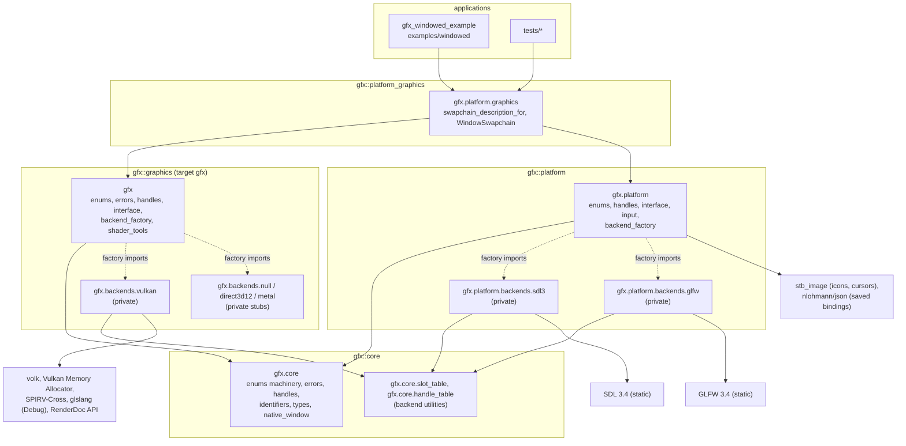

| Library | Source | Modules (public) | Namespace |
|---|---|---|---|
| core | `source/core/` | `gfx.core` = `gfx.core.enums`, `.errors`, `.handles`, `.types`, `.native_window`; plus `gfx.core.slot_table`, `gfx.core.handle_table` for backends | `gfx` |
| graphics | `source/graphics/` | `gfx` = `gfx.enums`, `gfx.errors`, `gfx.handles`, `gfx.interface` (one partition per object or concept), `gfx.backend_factory`, `gfx.shader_tools` | `gfx` |
| platform | `source/platform/` | `gfx.platform` = `gfx.platform.enums`, `.handles`, `.interface` (partitions), `.input` (partitions), `.backend_factory` | `gfx::platform` |
| bridge | `source/platform_graphics/` | `gfx.platform.graphics` (re-exports `gfx` and `gfx.platform`) | `gfx::platform` |

Rules every library follows:

- **One enumerations file per library** (`enums.cppm`): every enumeration and named constant, each with
  `EnumerationTraits` (names, bitmask or not) verified at compile time against the compiler's own
  spelling of each enumerator. `to_string`, `from_string`, `std::formatter` and the bitmask operators
  come from `gfx.core.enums`.
- **Typed handles** (`Handle<Tag>`, 32 bits: 24-bit slot, 8-bit generation) name objects in commands
  and events; only backends can create them (`HandleKey`, constructible by `HandleIssuer` only).
- **RAII**: objects are owned through `std::unique_ptr`; destruction releases (or defers the release
  until the GPU or the event pump no longer needs it).
- **Errors** name the backend, the operation, the problem and a suggestion; backends never degrade
  silently.
- **Native headers stay out of module purviews**: C headers in global module fragments, and headers
  that need `<windows.h>` or that conflict with `import std` in plain translation units behind small
  std-free headers (`vulkan_surface.hpp`, `glfw_native.hpp`, `json_reader.hpp`, `renderdoc_capture.hpp`).

## 2. Core: what the libraries share

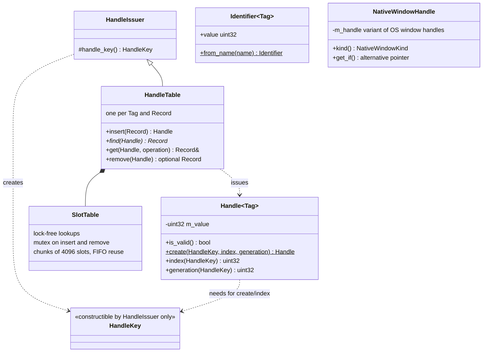

- **Handles vs identifiers**: a `Handle` is issued by a backend for an object that exists (a stale
  handle is detected by its generation); an `Identifier` is a compile-time hash of a name
  (`"jump"_action`, `"menu"_context`) chosen by the application.
- **`NativeWindowHandle`** carries operating-system handles only, as integers: the platform library
  produces it (`Window::native_handle()`), the graphics library consumes it (surfaces). Neither library
  depends on the other.
- **Handle tables** map a handle to a backend record (the native object and what commands need to know
  about it) with lock-free lookups, so any thread can resolve handles while recording.

Errors:

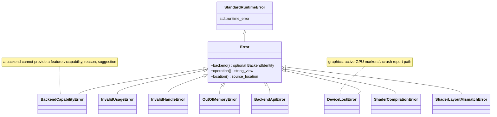

`BackendIdentity` is `{library, backend}`: messages start with `[gfx::VULKAN]` or `[gfx::platform::GLFW]`,
followed by the operation, the problem, a suggestion and the source location.

## 3. Graphics library

### 3.1 Object model

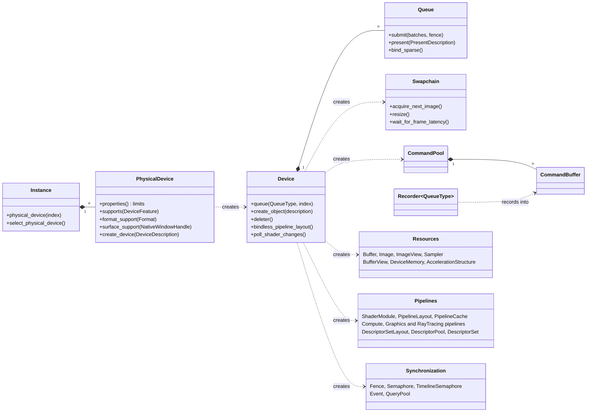

Objects are created by their parent and owned by the application (`std::unique_ptr`); commands and
descriptors name them by handle. Every interface operation is **pure virtual with a throwing default
definition**: a backend must override it, and may forward to the default, which throws a descriptive
`BackendCapabilityError`. The Null backend (an instance without devices) and the Direct3D 12 and
Metal stubs rely on that.

### 3.2 Recording

`Recorder<QueueType>` is a zero-cost typed wrapper over a `CommandBuffer`: methods are constrained by
the queue type, so `draw()` does not compile on a compute recorder. `begin_rendering()` returns a
`RenderingScope` (dynamic rendering, ended by its destructor); `begin_parallel_rendering()` returns a
`ParallelRenderingScope` whose parts are recorded on secondary command buffers by other threads
(`RenderingPartRecorder`) and executed in a fixed order. Barriers are synchronization2-style, derived
from `ResourceState` pairs (`image_barrier(image, before, after)`).

Per-frame helpers built on the interfaces (backend-independent): `FrameTimeline` (frame N signals N on a
timeline semaphore; the CPU runs at most `frames_in_flight` frames ahead), `FrameCommandPools` (one pool
per thread and frame in flight), `TransientBufferAllocator` (lock-free bump allocation in persistently
mapped memory), `Uploader` (staged uploads with barriers), `GpuProfiler` (timestamp scopes), and, in Debug
builds only (no-ops elsewhere), `FrameMetrics` (frame rate, CPU frame times over a period, the frame's
`CommandStatistics` summed over its command buffers, GPU timings, device memory) as lines of text. The
UI library's `gfx::ui::DebugOverlay` draws those lines (distance-field text over a translucent panel,
through `gfx::ui::UiRenderer`); the graphics library has no text of its own.

### 3.3 Vulkan backend

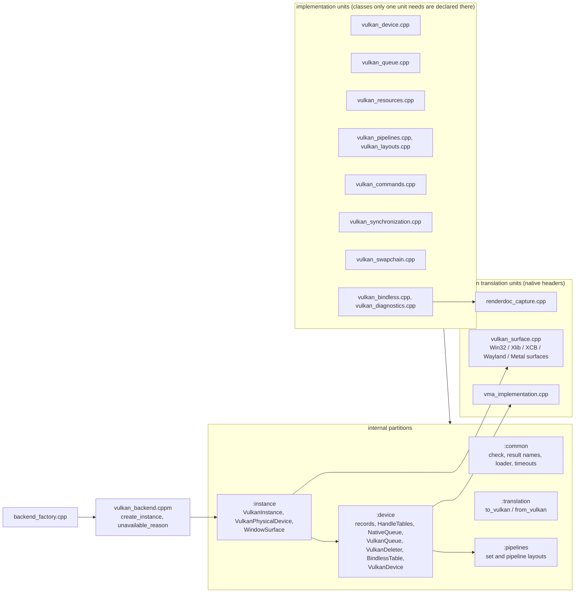

- **Records**: each handle table maps a handle to a record holding the native object and what commands
  need (an image's format, aspects, extent; a pipeline's atomic `VkPipeline` for asynchronous builds and
  hot reload). Records exist because commands receive only handles, which by design carry no pointer;
  the objects themselves belong to the application.
- **Queues**: each gfx queue maps to a `NativeQueue` (several gfx queues may share one when a family has
  fewer queues than requested). A native queue has a mutex and a **progress timeline**: every submission
  signals it, and the deleter runs a deferred destruction once every native queue has passed the value
  it had when the destruction was requested. Submissions that would deadlock a shared hardware queue
  (waiting for a value only a later submission to it signals) are refused.
- **Bindless table**: one update-after-bind descriptor set per device; resources register themselves
  when created; every command buffer binds it once.
- **Presentation**: surfaces are created from the `NativeWindowHandle` in `vulkan_surface.cpp`; a
  swapchain's images are registered in the image tables (not owned, not bindless) so barriers and
  rendering use their handles; a window without area has no native swapchain.

### 3.4 Shaders

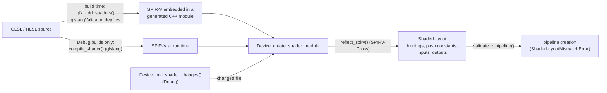

## 4. Platform library

### 4.1 Object model

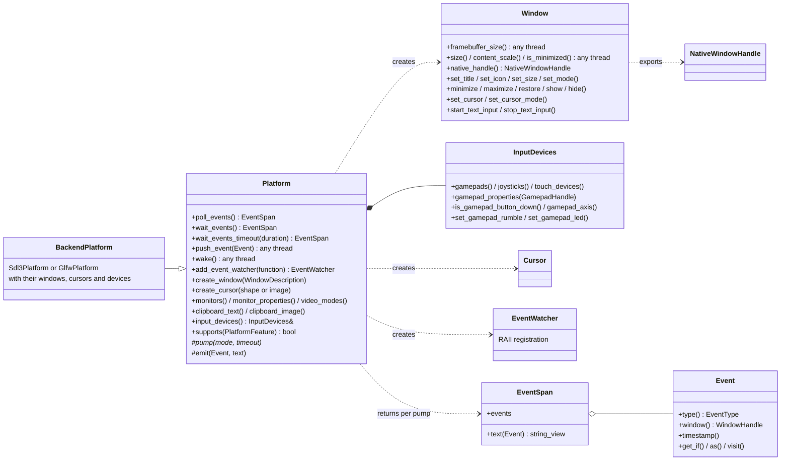

Monitors, gamepads, joysticks and touch devices are **handles** queried through the platform (they come
and go with the hardware); windows and cursors are objects the application owns. Destroying a window
closes it; its native resources are released at the next pump, never inside a backend callback.

### 4.2 Events

`Event` is a **value type of at most 64 bytes, trivially copyable**: an `EventType`, the window it concerns,
a timestamp, and a `std::variant` of payload structs (`WindowEvent`, `KeyboardEvent`, `MouseButtonEvent`,
`GamepadAxisEvent`, ...). Each payload lists the event types it serves (`TYPES`), so
`Event::make<EventType::KEY_DOWN>(...)` only accepts the matching payload, and `get_if` / `as` / `visit`
read it. Text (typed text, dropped file paths, IME compositions) lives in the span's text buffer, not in
the event. The `EventQueue` behind each pump is reused: **no allocation while pumping** in steady state.

### 4.3 The pump

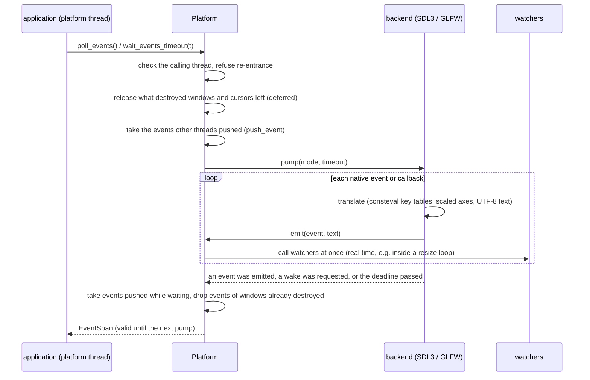

**SDL3 backend**: an SDL event watch translates the events SDL raises while it pumps (so watchers run in
real time, also inside Windows' modal resize loop); keys come as USB HID scancodes, as gfx's `Key`;
gamepads (rumble, LEDs, touchpads) through SDL's gamepad API; sizes are events only when they changed.
**GLFW backend**: callbacks deliver events during the pump and queue those GLFW raises outside it; keys
go through a `consteval` table from `GLFW_KEY_*` to `Key`, checked by `static_assert`s; gamepads and
joysticks are polled each pump and reported as differences. What a backend lacks (GLFW: touch, IME
composition, rumble, ...) throws `BackendCapabilityError`. One backend is active at a time.

### 4.4 Input: from events to actions

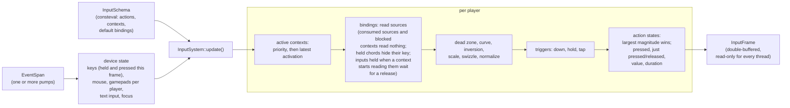

- The **schema** is built by `consteval` functions: actions (`BUTTON`, `AXIS_1D`, `AXIS_2D`), contexts
  (priority, consumes input, blocks lower contexts) and bindings. A wrong schema is a compile error whose
  message names the problem (`input_schema_error_two_actions_have_the_same_name()`).
- **Contexts** are activated per player and stay active while the returned `ContextActivation` lives.
- **Held inputs** (`ContextDescription::ignore_held_inputs`, on by default): each binding remembers which of
  its digital sources it could read in the previous frame; a source it starts to read (its context was
  activated, a context above stopped blocking or consuming it, text input ended) while held since an
  earlier frame reads as released until it is released. Presses that begin in the frame count; sticks,
  triggers and mouse motion are never ignored.
- **Players** own contexts, a gamepad (assigned automatically on first use or explicitly) and their action
  states; the keyboard and mouse belong to one player.
- **Rebinding**: `rebind`, `add_binding`, `remove_binding`, `capture_next_binding` (the captured press
  does not reach the actions), `find_bindings_using`; `save_bindings` / `load_bindings` write and read
  JSON naming keys and buttons (only bindings that differ from the defaults; loading is all or nothing).

### 4.5 Threads

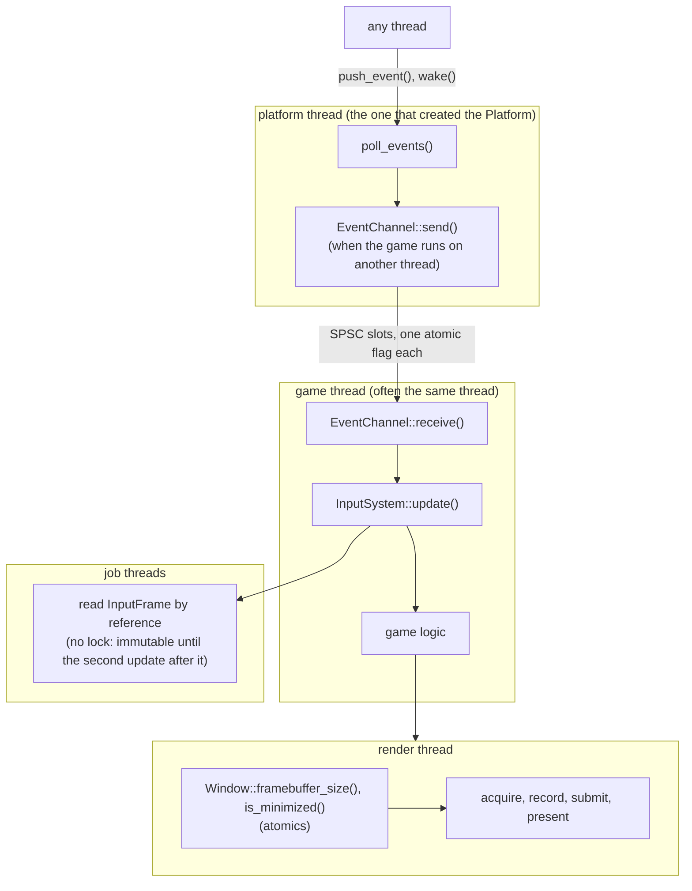

This is the arrangement of commercial engines (Unreal, Unity, Godot, SDL's rules): the operating system
requires window events on one thread; input is evaluated once per game frame into an immutable frame
that any number of job threads read; the render thread never touches the platform or the input system.

## 5. Bridge: presenting to a window

`gfx.platform.graphics` holds the only code that knows both libraries:
`swapchain_description_for(window)` (native handle and framebuffer size), the recreation rules
(`requires_swapchain_recreation(event or status)`), and `WindowSwapchain`.

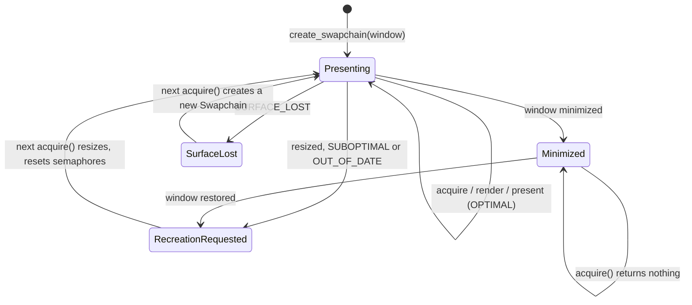

Semaphores: one **acquisition semaphore** per image plus one. Each acquisition takes a free one; when an
image comes back, the semaphore of its previous acquisition is free again (the image's presentation, and
therefore the rendering that waited on that semaphore, is over). One **rendering semaphore** per image:
the presentation engine may still hold the previous frame's semaphore, so reusing one per frame in flight
would be invalid.

One frame of the windowed example:

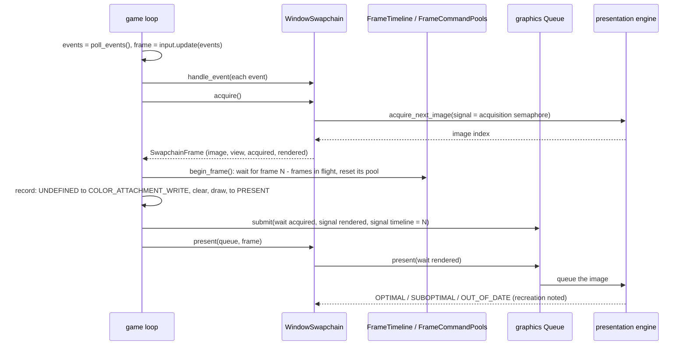

## 6. Build and tests

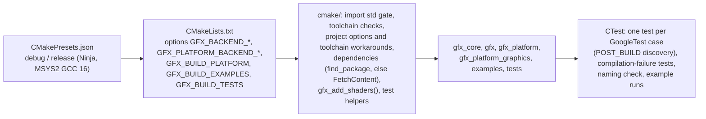

| Suite | What it covers |
|---|---|
| `tests/toolchain` | C++23 and `import std` conformance; **defect detectors** that pass while a GCC 16 / MinGW defect exists (each workaround stays only as long as its defect) |
| `tests/core` | enumeration machinery, errors, handles, identifiers, native window handles, slot tables |
| `tests/graphics/*` | enumerations, errors, handles, the interfaces through a fake backend, shader layouts and validation, shader tools; `vulkan`: the Vulkan backend on every GPU of the machine with the validation layers (any message fails a test) |
| `tests/platform` | the platform library through a fake platform: events, windows, the pump, watchers, threads, the input system (schemas, contexts, players, triggers, rebinding, saved bindings, `EventChannel`) |
| `tests/platform/backends` | the contract every platform backend honors (one parameterized suite run on SDL3 and GLFW, real windows), then SDL3 (injected events, virtual gamepads) and GLFW (Win32 messages) |
| `tests/platform_graphics` | presentation to visible windows on every platform backend and GPU: cleared frames read back, the UI renderer drawing into the window (with the UI library), resize, minimize, frame latency, unsupported settings |
| `tests/compilation` | code that must not compile (handle kinds that do not mix, draws on compute recorders, invalid input schemas, ...) and a check that no enumerator collides with a platform macro |
| `WindowedExample.*` | the windowed example, 120 frames on each platform backend with the validation layers (label `example`) |

Toolchain workarounds the build applies (each with a detector test): `--allow-multiple-definition`
for template static locals `import std` emits twice; `<windows.h>`, glfw3native.h, nlohmann/json and
Vulkan platform headers in plain translation units; handle-table lookups only in implementation units;
brace-initialized members of classes declared in partitions; `STBI_NO_STDIO` before stb_image; no
capturing lambdas in in-class constructors of classes declared across partitions. Details are in
`.claude/CLAUDE.md` §6.
