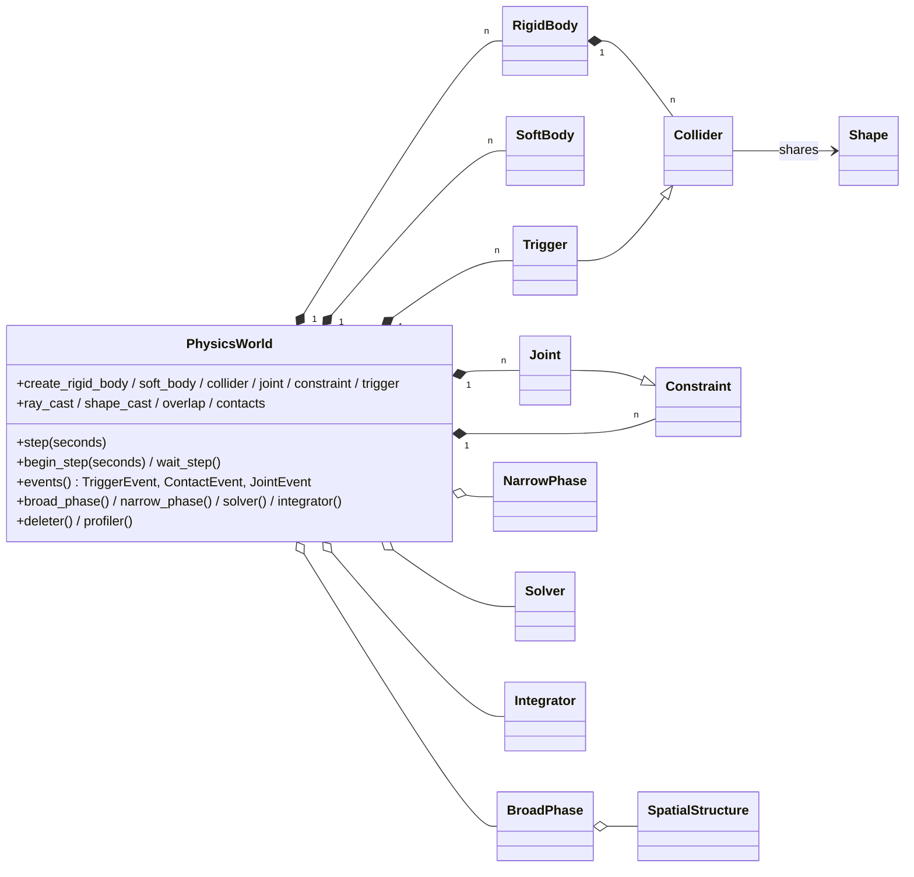

# gfx physics and camera: a decoupled physics abstraction over Box3D, and a camera module — architecture, decisions and plan

Status: **approved 2026-10-24** (every §D question as recommended, plus the math rule recorded there); **PH0 committed**
(636478b, §B "PH0 as built", deviations accepted); **PH1 implemented** (§B "PH1 as built"), awaiting validation. This
document answers the request
"C++23 physics abstraction library … Box3D … camera system". It follows the platform and UI designs' form: §0 lists
where the request meets the existing project (each with a recommendation and a question in §D), §A gives the
architecture and decisions, §B the implementation plan, §C the API as proposed, §D the questions.

Facts checked (2026-10-24):

- **Box3D exists**: Erin Catto's 3D engine, announced on 2026-06-30 ([box2d.org](https://box2d.org/posts/2026/06/announcing-box3d/),
  [github.com/erincatto/box3d](https://github.com/erincatto/box3d)), **MIT**, library in **C17** (samples C++20), **alpha**
  ("the API will change"), tag **v0.1.0** (61 commits), pull requests disabled, CMake presets for Windows, Linux, macOS
  and **MinGW**. From its public headers (`include/box3d/types.h`, `box3d.h`):
  - shapes: sphere, capsule, convex hull (boxes through `b3BoxHull`; no box, cylinder or cone type), triangle mesh, height
    field and baked compound (**the last three static only**); several shapes per body;
  - joints: parallel, distance, filter, motor, prismatic, revolute, spherical (cone and twist limits, spring, motor),
    weld (linear and angular springs), wheel; limits, motors, springs, friction; constraint force and torque getters;
    `forceThreshold`/`torqueThreshold` raise **joint events** (no automatic breaking);
  - surface material per shape: friction (one coefficient), restitution, rolling resistance; filtering by 64-bit category
    and mask bits plus a group index; custom filter, pre-solve, friction and restitution callbacks;
  - sensors (begin/end touch events, off by default), contact begin/end/hit events, body move and sleep events;
  - queries: ray cast, shape cast, overlap, character mover casts;
  - bodies: static, kinematic, dynamic; damping, gravity scale, motion locks, per-body sleep threshold, bullet (continuous)
    flag, fast rotation; "Soft Step" sub-stepping solver, continuous collision, island sleeping, warm starting toggle;
  - threading: `workerCount`, `enqueueTask`/`finishTask` callbacks (Box2D v3's task-system hooks); cross-platform
    determinism; recording and replay; a large-world variant with double positions;
  - **no soft bodies, cloth or ropes** (the weld joint's springs "mimic soft-body simulation"; the distance joint is
    "useful for ropes"), **no generic six-degree-of-freedom joint**, **no custom shapes, solver, integrator or broad phase**.
- Alternatives: **Jolt 5.6.0** (MIT, C++17; MSYS2 packages 5.3.0) has XPBD soft bodies (cloth, volumes), six-DOF and
  cone/swing-twist constraints and user shapes; **Bullet 3.25** (zlib, MSYS2) has soft bodies; PhysX 5 (BSD-3). None is
  installed here. **glm 1.0.3** (MIT, C++17 header library, MSYS2) ships a module interface since 1.0.0.
- GCC 16 evaluates `std::sqrt`, `sin`, `tan`, `atan2`, `abs` and `fma` in constant expressions (tested, even with
  `-pedantic-errors`); C++23 does not require it (C++26 makes part of `<cmath>` constexpr), so MSVC and Clang will not.
- The repository has **no audio, asset-loader or LOD abstraction**; its libraries are core, graphics, platform, the
  platform–graphics bridge and UI.

---

## 0. Where the request meets the existing project

| # | Request | Situation | Recommendation |
|---|---|---|---|
| 1 | A GitHub repository (`commercial-physics-abstraction`), git commands to push | Project rule: you commit and push; no `gh` here. Core, toolchain workarounds, CMake modules and test infrastructure live in this repository | **`source/physics/` in this repository** (targets `gfx::physics` and `gfx::camera`, namespaces `gfx::physics` and `gfx::camera`), as was decided for the UI; the requested layout is kept inside `source/physics/`. A separate repository would duplicate core and the toolchain workarounds and fetch gfx anyway. If you want one, I prepare it and give you the commands. |
| 2 | "Fully decoupled from graphics, audio, UI, asset-loader, LOD" | Physics and camera can depend on **gfx::core** only (enumeration machinery, errors, handles), as the platform library does | **Depend on core only**, and **prove it**: a CMake check fails the build if the physics or camera targets link (directly or not) graphics, platform or UI, and a source check refuses `import gfx.` of anything but `gfx.core*`, `gfx.physics*`, `gfx.camera*`. |
| 3 | `template<class Tag> struct Handle { std::uint32_t value; };` | Core has `class Handle<Tag>` (private 32-bit value: 24-bit slot, 8-bit generation; issued by backends through `HandleKey`) — your decision: a class, never `struct Handle` | **Core's `Handle<Tag>`**, one tag per resource kind. It is trivially copyable, constexpr-constructible, comparable, hashable, formattable, has no lookup structure inside, and detects stale handles by generation. |
| 4 | `PhysicsError : std::runtime_error`; `BackendCapabilityError` a `PhysicsError` subclass | Core has one hierarchy: `Error : std::runtime_error`, and `BackendCapabilityError : Error` is `final` (unchanged for the UI) | **`PhysicsError : gfx::Error`** naming the world, body, collider, joint, operation, backend, problem and suggestion; capability gaps throw **core's `BackendCapabilityError`** with a physics backend identity (`[gfx::physics::BOX3D] …`, the same context lines), so one `catch (const gfx::BackendCapabilityError&)` works across libraries. It is then not a `PhysicsError` subclass. |
| 5 | Queries return `std::expected`; unimplemented queries `std::unexpected(PhysicsError{…})` | A `PhysicsError` owns strings: building one allocates, in a hot path | **`std::expected<T, QueryFailure>`**: `QueryFailure` is a small value (a `QueryFailureKind`, the handles concerned, a static detail), no allocation; `failure.error()` builds the full `PhysicsError` for callers that want to throw it. A ray that hits nothing is a failure of kind `NO_HIT`. |
| 6 | `glm` for math | Core has small value types (`Vector2`, `Extent`, …). glm is a C++ header library: like msdfgen's headers (§6.11 of the project memory) its standard-library includes are expected to conflict with `import std` in a module unit (not tested); its module interface is unverified with GCC 16 | **Own constexpr math in core** (`gfx.core.math`: `Vector3`, `Vector4`, `Quaternion`, `Matrix3`, `Matrix4`, `Transform`), with `if consteval` implementations of square root and trigonometry so that compile-time use is portable (GCC folds `<cmath>`, MSVC and Clang do not yet). An optional header converting to and from glm can come later. |
| 7 | All enumerations in one `enums.cppm`; the camera "in its own module" but its enumerations "in the root `enums.cppm`" | Project rule: one enumerations file per library | **One library root `source/physics/`** holding both modules: `enums.cppm` (module `gfx.physics.enums`) has the physics **and** camera enumerations; the camera module (`gfx.camera`) imports only the enumerations, handles and geometric primitives, never a physics interface. Three targets: `gfx::physics_common` (enumerations, handles, errors, primitives), `gfx::camera` and `gfx::physics`, both on `physics_common`. |
| 8 | Box3D as the backend; "if the intended library is Bullet/Jolt/PhysX/Box2D-derived, treat it as that" | Box3D is real (above): MIT, C, alpha, no soft bodies, a fixed joint set, nothing pluggable | **The real Box3D, pinned** (tag v0.1.0 or a later commit, by URL and SHA-256), its C headers only in the backend's global module fragments. What it lacks throws `BackendCapabilityError` (§A11), except what the abstraction provides itself (next row). Jolt is the natural second backend later. |
| 9 | Soft bodies (PBD/XPBD, cloth, rope, tetrahedral) on the Box3D backend | Box3D has none | **The abstraction's reference XPBD solver** simulates soft bodies next to a Box3D world, colliding with its bodies' colliders through the abstraction's own narrow phase, two-way (impulses applied to Box3D bodies). The alternative reading — Box3D throws for soft bodies — leaves cloth, rope and volumes unusable until a second backend exists. |
| 10 | Sequential-impulse solver, broad phase, narrow phase and integrator as pluggable components; Box3D lets none be replaced | A component interface nothing can plug into is untestable | A **reference backend** composed only of the abstraction's components (`ReferenceWorld<BroadPhase, NarrowPhase, Solver, Integrator>`): sequential impulses, the spatial structures, GJK/EPA, the integrators. It proves the component contracts end to end and is the real template for custom backends; the null backend stays the template of the error contract. Proposed as a phase of its own (§B). |
| 11 | "Custom user backend must always be possible", a `PHYSICS_BACKEND_*` CMake hook, and "no system-wide globals" | The graphics and platform factories import compiled-in backends; a runtime registry would be a global | **Two ways, no global**: (a) a custom backend derives from the interfaces and the application constructs it directly; (b) the CMake option `GFX_PHYSICS_CUSTOM_BACKEND_TARGET` names a target that provides module `gfx.physics.backends.custom` (`unavailable_reason()`, `create_world()`), which the factory imports for `PhysicsBackendKind::CUSTOM`. Options `GFX_PHYSICS_BACKEND_BOX3D` and `GFX_PHYSICS_BACKEND_NULL`. |
| 12 | `PhysicsDesc`, `CameraDesc`, `create_camera(CameraDesc, CameraBackendKind)` | Naming rule: full words, `<Thing>Description` | `PhysicsWorldDescription`, `CameraDescription`, `create_physics_world(description, kind)`, `create_camera(description, kind)`; `Aabb`, `Obb`, `Bsp`, `Gjk`, `Epa`, `Xpbd` are acronyms (allowed). |
| 13 | CI on Linux, Windows and macOS | Only Windows/MinGW GCC 16 here; the project's step 6 is CI with MSVC, Clang and Linux | **No workflow file now** (it could not be run here); physics joins the project-wide CI of step 6. |
| 14 | "Compile time over run time" | — | Two layers for every component: **concepts** for compile-time composition (the reference backend and the spatial structures are templates: no virtual call in hot loops) and **virtual interfaces** for run-time selection (the factory, user plug-ins); shape and joint descriptions, convex hulls from point sets, ragdoll topologies and structure parameters are `constexpr`/`consteval`-checked when known at compile time. |

---

## A. Architecture and design decisions

### A1. Why decoupled, and how it is consumed

Physics answers questions about bodies in space; it has no reason to know how they are drawn, heard or streamed. Each
coupling would make a headless server, a tool or a test pull in a GPU device, a window or an audio mixer. So:

- `gfx::physics` and `gfx::camera` link `gfx::core` (and their own `gfx::physics_common`) and nothing else of gfx; the
  graphics, platform and UI libraries do not link physics. The checks of §0 row 2 fail the build otherwise.
- What crosses into other systems is plain values: transforms (`Transform`: position + unit quaternion), matrices
  (`Matrix4`, column-major floats), contact and trigger events. A renderer copies a camera's `view_projection()` into its
  push constants; a game copies body transforms into its scene. Neither library calls back into the engine.
- The camera does not depend on physics either: it imports the enumerations, the handles and the primitives (`Frustum`,
  `Ray`, `Aabb`, `Sphere`, `Obb`) of `physics_common`, which are geometry, not simulation.

### A2. Object model



- **`PhysicsWorld`** owns the simulation state of one world; several worlds coexist (no globals). The application owns
  every object it creates through `std::unique_ptr` (RAII, §A15); the world outlives them.
- **`Shape`** is immutable geometry, shareable between colliders (a hull used by a thousand crates is built once).
  **`Collider`** attaches a shape to a body with a local transform and a material (friction, restitution, rolling
  friction, density), a collision filter (layers, mask, group), the trigger flag and the constraint compatibility
  (whether joints may connect to it). A **`Trigger`** is a collider that reports overlaps instead of colliding.
- **`Constraint`** is what the solver orders: contacts, joints, soft-body attachments and user constraints, each with a
  `ConstraintKind`. **`Joint`** is the two-body constraint the application configures (`JointKind`: distance, hinge, ball
  and socket, slider, fixed, cone-twist, six-DOF, …; §A8).
- **`BroadPhase`, `NarrowPhase`, `Solver`, `Integrator`** are the world's pipeline. A backend reports its own (Box3D:
  `BroadPhaseKind::BVH`, `SolverKind::SOFT_STEP`, `IntegratorKind::SEMI_IMPLICIT_EULER`) and refuses replacements it
  cannot honor; the reference backend accepts any. **`SpatialStructure`** (BVH, octree, quadtree, BSP, uniform grid, sweep
  and prune) is what a spatial broad phase is built on, and is usable alone (game queries, culling).

### A3. Handles

- Core's `Handle<Tag>`, one tag per resource: `WorldTag`, `RigidBodyTag`, `SoftBodyTag`, `ColliderTag`, `ShapeTag`,
  `ConstraintTag`, `JointTag`, `TriggerTag`, `SpatialStructureTag`, `SpatialProxyTag` (an item inside a structure),
  `BroadPhaseTag`, `NarrowPhaseTag`, `SolverTag`, `IntegratorTag`, `ContactManifoldTag`, `CameraTag`,
  `CameraControllerTag`; aliases `RigidBodyHandle`, …; concepts `PhysicsHandle` (any of them), `BodyHandle` (rigid or soft),
  `ColliderHandle`-like and so on, as the request lists.
- **No maps**: a handle is a slot index and a generation into the issuing world's tables (core's thread-safe
  `HandleTable`, lock-free lookups). A stale handle is detected by its generation and reported (`InvalidHandleError` in
  operations, `QueryFailureKind::INVALID_HANDLE` in queries).
- **Backend internals stay private**: the Box3D backend's records hold `b3BodyId`, `b3ShapeId`, `b3JointId` (Box3D's own
  generation-checked ids); they appear in no exported declaration. User data pointers of Box3D carry our slot index, so
  events map back to handles without a search.
- Contact manifolds, events and query results carry handles, never pointers into backend storage.

### A4. Queries and errors in hot paths

`ray_cast`, `shape_cast`, `overlap`, `closest_point`, `contacts_of` return `std::expected<T, QueryFailure>` (`T`: a hit,
a span of hits written into caller storage, or a count). Failures: `NO_HIT`, `INVALID_HANDLE`, `STEP_IN_PROGRESS`,
`UNSUPPORTED` (with the capability), `CAPACITY_EXCEEDED`. Queries never throw and never allocate (results go into caller
spans or callbacks). Everything else throws (A16).

### A5. Broad phase

- **Contract**: `insert(collider, Aabb, CollisionFilter) → proxy`, `remove(proxy)`, `move(proxy, Aabb, displacement)`,
  `update()` (once per step), `pairs()` → the candidate pairs whose fattened bounds overlap and whose filters accept each
  other, **sorted** by (smaller collider handle, larger) — reproducible whatever the structure or the thread count;
  `new_pairs()` / `ended_pairs()` for contact bookkeeping.
- **Filtering**: 64-bit category and mask bits plus a group (Box3D's model: a positive shared group always collides, a
  negative one never), and an optional custom filter callable.
- **Incremental**: bounds are fattened (margin and displacement prediction), so a proxy moves in the structure only when
  it leaves its fattened box.
- **Any structure**: `SpatialBroadPhase<Structure>` adapts any `SpatialStructureConcept` (A7); the structure enumerates
  overlapping proxy pairs (its own traversal: tree against tree for BVH and BSP, per cell for grids, octrees and
  quadtrees, the sweep for SAP), the adapter filters, deduplicates and sorts.
- **Parallel**: the pair search is split into tasks over the task scheduler (A14); each task writes its own buffer, the
  buffers are merged in task order and sorted — the same pairs for one thread or sixteen.

### A6. Narrow phase

- **Convex shapes** satisfy `ConvexShape`: `support(direction) → point` and a `margin` (the radius of rounded shapes:
  sphere, capsule, rounded hull), plus their bounds. GJK works on the margin-free core.
- **GJK** answers intersection and distance (with closest points and the simplex); **EPA** grows the GJK simplex into
  the penetration depth and normal when the cores overlap; with margins, shallow contacts come from GJK distance alone
  (the common case, and the fast one).
- **Manifolds**: from the separating normal, the reference and incident features (faces of hulls, segments of capsules)
  are clipped against each other to give up to four points, each with a **feature id** (the pair of features that made
  it). The manifold cache keeps last step's points by feature id with their accumulated impulses for warm starting, so a
  box resting on the ground keeps the same four contacts frame after frame.
- **Analytic fast paths** where they are exact and cheaper: sphere–sphere, sphere–capsule, capsule–capsule,
  sphere–box, box–box (SAT: the one place a separating-axis test is the reference), segment–triangle. **SAT is otherwise
  a fallback** (triangle against triangle in mesh–mesh).
- **Meshes**: a BVH over the triangles; convex–mesh runs GJK against each candidate triangle; mesh–mesh traverses both
  BVHs and tests triangle pairs; height fields enumerate the cells under the other shape's bounds; compounds recurse
  into their children (through their own BVH when large).
- **Cylinders and cones** are convex shapes with exact support functions in the abstraction; a backend without them
  (Box3D) receives a hull approximation whose segment count the collider description sets.
- `NarrowPhase` is the interface (`collide(pair, previous manifold) → manifold`, queries per shape pair); the reference
  implementation is the abstraction's; a backend that has its own reports it.

### A7. Spatial structures

All six are written against the abstract primitives only (`Aabb` for storage; `Ray`, `Segment`, `Sphere`, `Obb`,
`Frustum` for queries through the primitives' intersection functions), so they are the same code under Box3D, the
reference backend, culling or game logic.

| Structure | Storage | Updates | Notes |
|---|---|---|---|
| BVH | dynamic AABB tree, fattened leaves, surface-area insertion, rotations | incremental | the default broad phase; also built bottom-up for static meshes |
| Octree | loose octree, `constexpr` depth and looseness | incremental | uniform 3D distributions |
| Quadtree | loose quadtree over two axes (`constexpr` plane: XZ by default), the third axis ignored | incremental | flat worlds |
| BSP | splitting planes chosen by surface-area heuristic, straddling items kept at the node | incremental inserts and removals, rebuilt when unbalanced | static-heavy scenes |
| Uniform grid | hashed cells of `constexpr` size | incremental | many similar small objects; soft-body self-collision |
| Sweep and prune | sorted endpoints on one or three axes, insertion sort per update | incremental, coherent | small, coherent scenes |

`SpatialStructureConcept` requires `insert`, `remove`, `update`, `query(Aabb | Ray | Segment | Frustum | Sphere, visitor)`,
`iterate(visitor)` and `pairs(visitor)`; `SpatialStructure` is the virtual interface wrapping any of them for run-time
choice. A test runs the same scene through all six and compares their pairs and query results with brute force.

### A8. Solver and constraints

- **Reference solver: sequential impulses** with accumulated impulses and **warm starting** (from the manifold cache and
  last step's joint impulses), a configurable velocity iteration count, **position correction** by non-linear Gauss–Seidel
  iterations (no Baumgarte energy gain), restitution above a **restitution threshold**, friction with **static** and
  **dynamic** coefficients (the static one while the sliding speed is under a threshold) and **rolling** friction (an
  angular constraint), **sleeping** by islands whose velocities stay under per-body thresholds for a time.
- **Determinism**: constraints are ordered by (`ConstraintKind`, smaller handle, larger handle, feature id) before
  iterating; islands are found in handle order; parallel solving is by graph colouring with a fixed colour order.
- **One `Joint` interface, many kinds**: distance (modes **rod**, **spring**, **rope** (a maximum length only), **stub**
  (meaning to confirm, §D), hinge (1 DOF), ball and socket (3 DOF), slider (1 DOF), fixed, cone-twist (2 DOF limits),
  generic six-DOF (per-axis free, limited or locked), and motor/servo drives on any free axis (velocity or position
  target with maximum force); **limits** per axis with softness; **breakable** joints (force and torque thresholds: the
  joint is disabled, reported by a `JointEvent`, and its object stays valid until the application destroys it).
- `Solver` exposes the reference (`SolverKind::SEQUENTIAL_IMPULSE`) and reports a backend's (`SOFT_STEP` for Box3D), with
  `SolverDescription` (iterations or sub-steps, warm starting, thresholds); per-constraint settings live on the joint.

### A9. Soft bodies

- **Reference path: XPBD** (extended position-based dynamics with compliance, so stiffness does not depend on the
  iteration count or time step): particles with inverse masses; stretch and shear distance constraints, bending
  (dihedral), tetrahedral volume constraints, long-range attachments; sub-steps; damping.
- **Volumetric**: a tetrahedral mesh given by the application (positions and tetrahedra), with volume preservation and
  per-tetrahedron compliance. A backend with native volumes (Jolt) may run it natively; Box3D cannot, so the reference
  path runs it.
- **Cloth and rope are presets**, not separate APIs: `cloth_preset(columns, rows, spacing)` and `rope_preset(segments,
  length)` produce a `SoftBodyDescription` (particles, constraints, default compliances) that the application may still
  edit.
- **Pinning**: a particle pinned to a point of the world or to a point of a rigid body (an attachment constraint);
  **collision with rigid bodies**: particle spheres against the colliders through the abstraction's narrow phase,
  friction, two-way (the impulse is applied to the body through the backend); **self-collision** toggled per soft body
  (a uniform grid over the particles); stiffness given as compliance, damping per body.

### A10. Rigid bodies and colliders

- `BodyKind`: static, kinematic, dynamic. Mass from the colliders' densities or given; **inertia tensor** computed
  (principal moments and frame) or given; **center of mass** computed or given; linear and angular damping, gravity scale,
  sleep thresholds, `MotionQuality` (discrete or continuous), per-axis motion locks.
- Colliders (the "tools layer"): sphere, capsule, cylinder, cone, box, **convex hull built from points** (quickhull;
  `consteval` for point sets known at compile time, with the hull's capacity as a template argument), triangle mesh,
  height field (`std::mdspan` of heights), compound. Each carries friction (static, dynamic, rolling), restitution,
  density, filter, trigger flag and constraint compatibility.
- **Triggers** emit `ENTER`, `STAY` and `EXIT` events into the world's `TriggerEvent` queue (read after a step; `STAY`
  is produced every step while an overlap lasts — Box3D reports begin and end only, the backend keeps the overlap set).

### A11. Integrators

- A separate interface because integration is a choice independent of collision and constraints (a soft body's
  stability, a particle system's cost), and because some backends want one supplied. `Integrator` works on spans of
  particle or body states (structure of arrays: positions, velocities, inverse masses, accumulated forces, previous
  positions): `predict(state, seconds)` and `finalize(state, seconds)` — one step for explicit schemes, the prediction and
  velocity update around constraint projection for XPBD — plus `requirements()` (previous positions, force evaluations
  per step).
- Implementations: **semi-implicit Euler**, **Verlet** (position Verlet), **RK4** (with a force-field callable evaluated
  four times), **XPBD** (prediction and velocity update; projection is the soft-body solver's).
- **Backends that do not take one still conform**: a Box3D world's `integrator()` describes Box3D's own integration
  (`IntegratorKind::SEMI_IMPLICIT_EULER`, `is_external() == false`); asking it to integrate rigid bodies with another
  throws `BackendCapabilityError`. The reference soft bodies under Box3D accept any integrator meeting their requirements.

### A12. The Box3D backend

| Request | Box3D | In the backend |
|---|---|---|
| Rigid bodies (kinds, mass, damping, sleep, CCD, locks) | yes | mapped one to one (`isBullet` for continuous) |
| Sphere, capsule, hull, box | yes (box = `b3BoxHull`) | mapped; boxes as box hulls |
| Cylinder, cone | no type | hulls built by the abstraction (segment count in the description) |
| Triangle mesh, height field, compound | **static only** (runtime compounds = several shapes on a body) | static: mapped; on a dynamic or kinematic body: `BackendCapabilityError` (suggestion: convex decomposition into hulls, or a compound of hulls) |
| Static and dynamic friction | one coefficient | equal coefficients accepted; different ones: `BackendCapabilityError` |
| Rolling friction, restitution, restitution threshold | yes | mapped |
| Layers, masks, groups, custom filter | yes (64-bit) | mapped |
| Distance (rod, spring, rope), hinge, ball and socket, slider, fixed | distance, revolute, spherical, prismatic, weld | mapped |
| Cone-twist | spherical joint with cone and twist limits | mapped |
| Generic six-DOF | no | `BackendCapabilityError` (suggestion: the joint kinds above, or a backend with six-DOF joints) |
| Motors, servos, limits, springs | yes | mapped per joint kind |
| Breakable joints | thresholds raise joint events | the backend disables the joint on its event and reports `JointEvent::BROKEN` |
| Triggers | sensors (begin and end) | mapped; `STAY` synthesized |
| Ray, shape and overlap queries | yes | mapped; plus the abstraction's own (BVH + GJK) on request |
| Soft bodies | no | the abstraction's XPBD next to the Box3D world (§0 row 9) |
| Replacing broad phase, narrow phase, solver, integrator | no | the backend reports its own; replacing throws `BackendCapabilityError` |
| Determinism, task hooks | yes | `enqueueTask`/`finishTask` forwarded to the world's task scheduler |

A custom backend implements the same interfaces (the null backend shows every operation and the error it throws when
unsupported) and is selected as §0 row 11 says. If Box3D keeps Box2D's process-wide settings (allocator, assertion
handler), the backend leaves them at their defaults (to verify when it is wrapped).

### A13. Camera module

- **Abstract `Camera`** with a standard implementation and room for custom ones (off-axis stereo, oblique near planes,
  jittered projections); `create_camera(description, CameraBackendKind::STANDARD)`; every matrix function is also a
  `constexpr` free function usable without any camera object.
- **Conventions**: right-handed world and view space; the camera looks along −Z with +Y up in view space; orientation is
  a **unit quaternion** (Hamilton convention, w first; rotations compose right to left, `q2 * q1` applies `q1` first;
  vectors rotate as `q v q*`), renormalized after each change. Yaw (about +Y), pitch (about +X) and roll (about −Z) are
  **read from** and **built into** quaternions (`set_orientation_from(yaw, pitch, roll)`, `rotate(axis, angle)`,
  `look_at(target, up)`); no Euler state is kept, so no gimbal lock can appear in the camera itself.
- **Projections**: perspective (vertical field of view, aspect ratio, near, far or infinite far, reverse depth) and
  orthographic (width and height or the six bounds, near, far, reverse depth). Clip conventions are the caller's choice
  in the description — depth range `ZERO_TO_ONE` (default: Vulkan, Direct3D, Metal, WebGPU) or `NEGATIVE_ONE_TO_ONE`
  (OpenGL), normalized-device y up (default) or down (Vulkan without a flipped viewport) — so the camera serves any
  renderer without knowing it.
- **Outputs**: `view`, `projection`, `view_projection`, `inverse_view`, `inverse_projection`, `inverse_view_projection`
  (`Matrix4`, column-major); `frustum()` (six world-space planes, normals inward, extracted from the view-projection
  matrix with the depth convention applied); culling helpers for spheres, AABBs and OBBs (`OUTSIDE`, `INTERSECTING`,
  `INSIDE`); `screen_to_world_ray(point, viewport)` (unprojects the near and far points; parallel rays for orthographic
  cameras; reverse and infinite depth handled).
- **Unit-agnostic**: no unit is assumed anywhere (near and far are whatever the caller's unit is).
- **`CameraController`** (optional; free-fly, orbit, first-person) updates a camera from a `CameraControllerInput` of plain
  values (movement, look deltas, zoom, seconds) — not from the platform library's events, which the application
  translates — and is where limits such as pitch clamping live.

### A14. Threading

- **Asynchronous stepping**: with `PhysicsWorldDescription::asynchronous_stepping`, the world owns one `std::jthread`
  worker (stopped through its `std::stop_token` when the world is destroyed); `begin_step(seconds)` hands the step to it
  and returns at once, `wait_step()` waits for its end, `step(seconds)` does both. Without it, steps run on the caller.
- **Deferred edits**: every mutation (create or destroy a body, set a transform or a velocity, add a force or an impulse,
  change a joint) is **recorded and applied at the start of the next step**, in the order recorded — one rule whatever
  the timing, so a replay with the same edits gives the same result. New objects get their handles at once; getters
  return the state of the last completed step.
- **Parallel hooks**: `TaskScheduler` (the application's job system: `parallel_for(count, minimum_range, task)` and
  `wait(group)`) given in the description; the reference broad and narrow phases split their work over it with
  deterministic merges; Box3D's `enqueueTask`/`finishTask` are forwarded to it; without one, work runs on the stepping
  thread. Single-threaded backends conform by ignoring it.
- **Read-only queries from any number of threads while no step runs**, through a reader handshake: a query increments
  the world's reader count and then reads the stepping flag; `begin_step` sets the flag and then waits for the reader
  count to reach zero. Both pairs of operations are `memory_order_seq_cst` (a store-then-load on each side, which weaker
  orders do not order), so a query that started before a step finishes before the step mutates anything, and a query
  that starts during a step returns `STEP_IN_PROGRESS` without blocking. The end of a step is a release store; queries
  and getters acquire it, so they see every effect of the completed step.
- **No globals**: every piece of state belongs to a world (or a camera); two worlds step concurrently on two threads.

### A15. RAII and deferred deletion

Every object is created by its parent and owned by the application (`std::unique_ptr`): destruction destroys. During a
step (or while queries hold the world), destruction is queued to the world's **deleter**, drained at the start of the
next step after the deferred edits. Objects hold a weak lifetime token of their world: after the world is gone their
operations throw `PhysicsError` ("the world was destroyed") instead of touching freed memory. Joints whose body was
destroyed are detached: their handle no longer resolves, and their operations throw naming the destroyed body. Objects
are non-copyable and movable where a moved-from state is meaningful (descriptions and value types; world objects are
held by `unique_ptr`).

### A16. Errors

- `PhysicsError : gfx::Error`: message `[gfx::physics::BOX3D] RigidBody::set_mass_properties: <problem>` followed by
  `World: World(index 0, generation 1)`, `Body: RigidBody(index 12, generation 3)`, `Collider: …`, `Reason`, `Suggestion`,
  `Location`; accessors for the handles.
- Capability gaps: core `BackendCapabilityError` with the physics backend identity, the capability name (an enumerator of
  `PhysicsCapability`), the same context lines and a suggestion (§0 row 4).
- Queries: `QueryFailure` (§A4). Destructors never throw.

### A17. Modules and layout

```
source/physics/                      gfx::physics_common, gfx::physics, gfx::camera
  enums.cppm                         gfx.physics.enums — every physics and camera enumeration and constant
  handles.cppm                       gfx.physics.handles — tags, aliases, concepts
  errors.cppm                        gfx.physics.errors — PhysicsError, QueryFailure, throw helpers
  primitives/                        gfx.physics.primitives — aabb, sphere, obb, convex_hull, ray, segment, frustum (+ plane)
  camera/interface/                  gfx.camera — camera.cppm, camera_controller.cppm (+ standard implementations)
  camera_factory.cppm                gfx.camera.factory — create_camera()
  interface/                         gfx.physics.interface — physics_world, rigid_body, soft_body, collider, shape,
                                     constraint, joint, broad_phase, narrow_phase, solver, integrator,
                                     spatial_structure, trigger, query (+ deleter, profiler, task_scheduler)
  narrow_phase/                      gfx.physics.narrow_phase — gjk, epa, manifold (+ sat, analytic, mesh)
  spatial/                           gfx.physics.spatial — bvh, octree, quadtree, bsp, uniform_grid, sweep_and_prune
  dynamics/                          gfx.physics.dynamics — integrators, sequential impulses, XPBD (reference components)
  backends/box3d/, backends/null/    private file sets, imported only by the factory
  physics_factory.cppm               gfx.physics.factory — create_physics_world()
source/core/math.cppm                gfx.core.math — vectors, quaternion, matrices, transforms (constexpr)
```

`.cppm` modules throughout (`import std;`), headers only where a module cannot serve (Box3D's C headers in the backend's
global module fragments, as SDL's are). `import gfx.physics;` re-exports everything public except the backends;
`import gfx.camera;` re-exports the camera and the primitives it uses.

### A18. Naming

As the project: snake_case functions, PascalCase types and concepts, `m_` members of classes (none in description
structs), SCREAMING_SNAKE_CASE enumerators and constants in `enums.cppm` only, full words (`PhysicsWorldDescription`,
`MAXIMUM_`, `minimum_range`), acronyms allowed (`Aabb`, `Obb`, `Bsp`, `Gjk`, `Epa`, `Xpbd`, `Bvh`), names that platform
headers define as macros avoided.

---

## B. Implementation plan

Each phase is built, tested (Debug and Release, every test in CTest), reported and validated before the next, as before.

| Phase | Content | Tests |
|---|---|---|
| **PH0 Foundations** | `gfx.core.math`; `source/physics` targets and options; enumerations, handles, errors, `QueryFailure`; primitives with constexpr constructors and intersection tests (point, Aabb, Sphere, Obb, Ray, Segment, Frustum, Plane); the decoupling checks | math and primitives at compile time (`static_assert`) and run time; compile-failure tests (handles of different kinds, decoupled imports) |
| **PH1 Camera** | `Camera`, standard perspective/orthographic implementation, clip conventions, frustum extraction, culling, `screen_to_world_ray`; controllers (free-fly, orbit, first-person); `camera_factory` | matrices against hand-computed values for every convention; round trips (project then unproject); culling of boxes on both sides of every plane; constexpr cameras |
| **PH2 Shapes and narrow phase** | convex shapes and support functions, quickhull (`consteval` variant), GJK, EPA, analytic pairs, SAT box–box, manifolds with feature ids and the manifold cache; mesh BVH, convex–mesh, mesh–mesh, height fields, compounds | against analytic answers (distances, depths, normals) over randomized poses; manifold stability (feature ids kept across small motions) |
| **PH3 Spatial structures and broad phase** | BVH, octree, quadtree, BSP, uniform grid, sweep and prune; `SpatialBroadPhase<Structure>`, filtering, deterministic pairs, parallel pair search | every structure against brute force (pairs and queries) over thousands of moving boxes; identical pairs with 1 and N threads |
| **PH4 Interfaces, null backend, threading** | every interface with throwing defaults; null backend; factory; deferred edits, deleter, asynchronous stepping, reader handshake, task scheduler | the error contract on every operation; edits applied in order; queries from threads during and between steps |
| **PH5 Box3D backend** | Box3D fetched and pinned; worlds, bodies, colliders, joints, triggers (`STAY`), events, breakable joints, queries, task hooks; capability errors of §A12 | simulations with known outcomes (free fall, resting stacks, pendulums against analytic periods, joint limits), determinism (two runs, same bits), each capability error |
| **PH6 Integrators and soft bodies** | semi-implicit Euler, Verlet, RK4, XPBD; XPBD soft bodies (cloth, rope, tetrahedral volumes), pinning, rigid coupling with Box3D, self-collision | integrators against analytic orbits and springs (energy drift bounds); cloth hanging from two pins settles; a rope's length holds; two-way coupling moves a Box3D body |
| **PH7 Reference backend** | `ReferenceWorld<BroadPhase, NarrowPhase, Solver, Integrator>` with sequential impulses (warm starting, friction models, restitution threshold, sleeping), its joints, the factory's `REFERENCE`… or `CUSTOM` slot (per your answer) | the PH5 scenarios on the reference backend; swapping each component |
| **PH8 Sample and documentation** | `examples/physics` (headless: the request's usage example, asserting the step, the query and the camera math; CTest); README sections; THIRD_PARTY_LICENSES.md (Box3D); architecture overview with diagrams | the sample under CTest |

### PH0 as built (2026-10-24)

**Math in core** — module `gfx.core.math` (`source/core/math.cppm`, in target `gfx::core`, not in the `gfx.core` umbrella:
`import gfx.core.math;`). Conventions: right-handed, column vectors, column-major matrices (as graphics APIs and cglm),
Hamilton quaternions, yaw/pitch/roll = intrinsic Y-X-Z (roll applied first). Types: `Vector3` (12 bytes), `Vector4`,
`Quaternion` (identity by default), `Matrix3`, `Matrix4` (identity by default), `YawPitchRoll`, `Transform` {position,
orientation}. Every function is `constexpr` and has two paths through `if consteval`:

- **compile time**: own code — `square_root` (Newton in double), `sine`/`cosine`/`tangent`/`arc_tangent`/`arc_sine`/
  `arc_cosine` (range reduction + series), cofactor inverses — so constant expressions work with every compiler, not
  only with GCC's folding of `<cmath>`;
- **run time**: `<cmath>` for scalars and **cglm 0.9.6** for the 4-wide types (`Matrix4` products, matrix × vector,
  transpose, determinant, inverse, rigid inverse; `Matrix3` products; quaternion products and normalization; `Vector4`
  arithmetic, dot, minimum/maximum), the values copied to and from cglm's arrays with `std::bit_cast` (same layouts,
  static-asserted). cglm's `static inline` functions are included in the module's global module fragment
  (`CGLM_ALL_UNALIGNED`): GCC 16 warns that exported inline functions expose TU-local entities; verified to compile, link
  and run correctly, so `-Wno-expose-global-module-tu-local` is set on `math.cppm` only.
- **batches** (SIMD over many elements): `transform_points` / `transform_vectors` (by a `Matrix4` or a `Transform`) and
  `multiply_add` (floats, `Vector3`s), on kernels of our own written with **SIMDe 0.8.2**'s SSE intrinsics in a plain
  translation unit (`math_kernels.cpp` behind the std-free `math_kernels.hpp`: SIMDe's headers include `<stdio.h>` and
  `<memory>`, which cannot share a unit with `import std`, §6.11 of the project memory). Short outputs throw
  `InvalidUsageError`; constant expressions take the scalar path.

`GFX_SIMD_INSTRUCTION_SET` (cache variable: `SSE2` default, `AVX2`, `NATIVE`) feeds the INTERFACE target
`gfx::simd_options`, linked PUBLIC by core so inline SIMD code is compiled alike in consumers. It also sets
**`-ffp-contract=off`**: no fused multiply-add is formed behind our back, so the scalar and SIMD paths (and builds with
different instruction sets) compute the same bits — the batch tests compare them exactly.

**Physics foundations** — `source/physics/`, option `GFX_BUILD_PHYSICS` (ON), target **`gfx::physics_common`**
(`gfx_physics_common`: PUBLIC `gfx::core`, PRIVATE SIMDe); `gfx::camera` and `gfx::physics` come with PH1 and PH4.

- `gfx.physics.enums` (`enums.cppm`, generated): 22 enumerations — the C1 excerpt plus `PhysicsSubsystem` {GEOMETRY,
  SPATIAL, NARROW_PHASE, DYNAMICS, SOFT_BODIES, WORLD} (with `PhysicsBackendKind`, the backend identities of errors:
  `[gfx::physics::GEOMETRY]`), `PhysicsCapability` (16: what a `BackendCapabilityError` names), `BroadPhaseKind`,
  `NarrowPhaseKind`, `FrustumPlane`, `PlaneSide`, `AxisPlane`, `LayerMask` (64-bit bitmask `LAYER_0`..`LAYER_63`) — and the
  constants `ALL_LAYERS`, `MAXIMUM_MANIFOLD_POINTS`, `DEFAULT_RESTITUTION_THRESHOLD`, `GEOMETRIC_TOLERANCE`. The camera's
  enumerations join this file in PH1.
- `gfx.physics.handles`: 17 tags (world, rigid body, soft body, collider, shape, constraint, joint, trigger, spatial
  structure and proxy, broad phase, narrow phase, solver, integrator, contact manifold, camera, camera controller) with
  their `Handle` aliases; concepts `PhysicsHandle`, `BodyHandle`, `CollisionObjectHandle`, `ConstraintObjectHandle`,
  `SpatialHandle`, `CameraObjectHandle`.
- `gfx.physics.errors`: `PhysicsError : gfx::Error` (`PhysicsErrorDescription` {backend, operation, problem, suggestion,
  `PhysicsErrorContext` {world, rigid_body, soft_body, collider, shape, joint, trigger}}; one message line per object
  concerned), `throw_unsupported(backend, operation, PhysicsCapability, reason, suggestion, context)` → core
  `BackendCapabilityError`, `QueryFailure` {kind, operation, detail (static text), backend, capability, context;
  `message()`, `raise()`} and `QueryResult<T> = std::expected<T, QueryFailure>`.
- `gfx.physics.primitives` (partitions; re-exports `gfx.core.math` and the enumerations): `Plane` (unit normal, distance;
  `from_point_normal`, `from_points`, `from_coefficients` — a vector without direction gives a plane everything is in
  front of), `Aabb` (`empty`, `from_center`, `from_points`, `merged`, `expanded`, `closest_point`, `transformed` by a matrix
  (Arvo) or a transform, …), `Sphere`, `Obb` (center, half extents, orientation), `Ray`, `Segment` (+ `closest_points` of
  two segments), `ConvexHullView` / `FixedConvexHull<V, F>` (constexpr; `box_hull()`) / `ConvexHull` (owns its arrays,
  validates the faces against the vertices), `Frustum` (`from_matrix(matrix, DepthRange, reversed_depth)`: Gribb–Hartmann
  planes facing in; an infinite far plane becomes a plane without direction), the concept **`ConvexShape`** (support,
  margin, bounds) with `support_point()`, and the tests: `intersects` (box–box, sphere–sphere, box–sphere, oriented boxes by
  the 15-axis separating axis test, oriented box–box/sphere, segment–box/sphere), `classify` (plane or frustum against a
  box, sphere or oriented box → `PlaneSide` / `FrustumIntersection`), `ray_distance` (box, sphere, oriented box, plane,
  hull; optional maximum) → `std::optional<float>`.
- **Batch culling**: `classify(frustum, span<const Aabb>, span<FrustumIntersection>)` and the `Sphere` overload, on SIMDe
  kernels (`primitive_kernels.cpp`, plain translation unit): the six planes in two registers of four lanes (two dummy
  lanes everything is in front of), one element per iteration, the same operations in the same order as the scalar
  `classify()` — identical results, volumes exactly on a plane included. The batches use one thread; callers that cull
  in parallel give each job its own part of the spans (the functions keep no state). Multithreaded work inside the
  library (pair search, islands, stepping) comes with the task scheduler (PH3, PH4).
- **Decoupling, proven**: `gfx_require_decoupled(gfx_physics_common FORBIDDEN gfx gfx_platform gfx_platform_graphics
  gfx_ui gfx_ui_platform gfx_ui_atlas_tools)` (`cmake/GfxDecoupling.cmake`) walks the target's whole link closure at the
  end of configuration (deferred, so targets declared later count; generator expressions are searched for target names)
  and stops the configuration naming the path to a forbidden target (checked once by linking one through a
  `$<$<CONFIG:Debug>:…>` expression). `cmake/scripts/GfxCheckModuleImports.cmake` scans sources for `import gfx…;`: CTest
  `PhysicsDecoupling.SourcesImportOnlyCoreAndPhysics` (allowed prefixes `gfx.core`, `gfx.physics`, `gfx.camera`, matched
  on whole name components) and `PhysicsDecoupling.ForbiddenImportsAreFound` (a fixture importing `gfx.platform` and
  `gfx.camerawork` must be reported).

Tests: `gfx_core_tests` + 8 `MathTest.*` (compile-time values recomputed at run time on the cglm/SIMDe paths, conventions,
batches against one element at a time, short outputs); **`gfx_physics_common_tests`** (20: enumerations spelled and
parsed, handles, errors and query failures; 75 `static_assert`s on primitives and intersections; oriented boxes against the projections
of their corners on the 15 axes (4000 random pairs), segment closest points against a sampled reference, hull validation,
frustums from matrices in both depth ranges, reversed and infinite; frustum classification against the corners, rays
against hulls and surfaces, segments against rays; batches equal to the scalar results for three frustums × 4125 boxes
and spheres, every length 0–9 at four offsets, short outputs); the two decoupling tests; compile-failure tests
`PhysicsHandlesOfDifferentKindsDoNotCompare`, `ConvexShapesNeedAMargin`.

Deviations from the proposal, for validation:

1. **Concept names**: the request names concepts `ColliderHandle`, `ConstraintHandle` and `CameraHandle`, but those
   names are the handle aliases (`using ColliderHandle = Handle<ColliderTag>`); the concepts are
   `CollisionObjectHandle` (collider or trigger), `ConstraintObjectHandle` (constraint or joint), `CameraObjectHandle`
   (camera or controller).
2. **`ConvexShape` lives in the primitives** (it needs `Vector3` and `Aabb`), not in `handles.cppm`.
3. **`Vector3` stays scalar** (12 bytes, no padding: arrays of positions stay packed); SIMD reaches it through the batch
   functions. cglm's own 3-component functions are scalar too.
4. **Quaternions are stored x, y, z, w** (cglm's layout) — the constructors take named fields, so the order shows only
   in memory.
5. **Decoupled imports are checked by a CTest scan**, not a compile-failure test (a failing compile would only show that
   one file fails, not that every source keeps to the rule).
6. **`ConvexHull` takes vertices and face planes** in PH0 (validated); building a hull from a point set (quickhull, and
   the `consteval` `convex_hull<N>(points)` of §C2) is PH2's, as planned.

### PH1 as built (2026-10-24)

Target **`gfx::camera`** (`gfx_camera`, PUBLIC `gfx::physics_common`), `import gfx.camera;`, namespace `gfx::camera`, in
`source/physics/camera/`:

| Module | Content |
|---|---|
| `gfx.camera` (camera.cppm) | umbrella: the interface and the factory |
| `gfx.camera.interface` (interface/) | re-exports gfx.core.math, gfx.core.types, gfx.core.errors, gfx.physics.enums, gfx.physics.errors, gfx.physics.primitives; partitions `:projection`, `:camera`, `:controller`; implementation units camera.cpp, controller.cpp |
| `gfx.camera.factory` (camera_factory.cppm/.cpp) | `CameraBackendAvailability`, `camera_backend_availability()`, `available_camera_backends()`, `create_camera(description = {}, kind = STANDARD)`, `create_camera_controller(description, kind = STANDARD)` |
| `gfx.camera.backends.standard` (backends/standard/, private file set) | `StandardCamera` and the three controllers, declared in their implementation units; imported only by the factory's implementation |

- **Enumerations** (in `source/physics/enums.cppm`, namespace `gfx::camera`, generated by the PH1 script):
  `CameraBackendKind` {STANDARD, CUSTOM} (BACKEND_LIBRARY "gfx::camera": `[gfx::camera::STANDARD] ...`),
  `CameraProjectionKind`, `CameraControllerKind` {FREE_FLY, FIRST_PERSON, ORBIT}, `NormalizedDeviceYAxis` {UP, DOWN},
  `ReferenceFrame` {WORLD, LOCAL}; constant `INFINITE_FAR_PLANE`. The primitives the camera uses are named in its namespace
  too (`using physics::Frustum;` … `Ray`, `Aabb`, `Sphere`, `Obb`, `Plane`, `DepthRange`, `FrustumIntersection`, `FrustumPlane`).
- **Values and constexpr functions** (`:projection`): `PerspectiveProjection` {vertical_field_of_view, aspect_ratio,
  near_plane, far_plane}, `OrthographicProjection` {left, right, bottom, top, near_plane, far_plane} + `orthographic(
  OrthographicSize)`, `CameraProjection = std::variant<…>`, `ClipConventions` {depth_range, reversed_depth, y_axis},
  `CameraDescription` {projection, clip, position, orientation}, `ScreenViewport` {x, y, width, height}; `perspective_matrix`,
  `orthographic_matrix`, `projection_matrix`, `view_matrix`, `view_projection_matrix`, `camera_transform`,
  `orientation_toward`, `look_at_orientation` (→ optional), `camera_frustum` (from a matrix and conventions, or a
  description), `screen_to_normalized_device`, `screen_to_world_ray`, `world_to_screen` (→ optional: pixels and clip depth),
  `camera_problem` (→ optional `CameraProblem` {problem, value, suggestion}). One depth formula covers every convention:
  clip depth `(A z + B) / -z` (perspective) or `A z + B` (orthographic) with A and B solved so that the near and far planes
  land on the convention's depths, and the limit as the far plane goes to infinity; +Y down negates the y row, and
  `camera_frustum` swaps the bottom and top planes back so that plane names stay true.
- **`Camera`** (`:camera`): non-copyable, `backend()`; pure virtual state (`description`, `position`, `orientation`,
  `projection`, `clip_conventions`), setters (`set_position`, `set_orientation` (normalizes), `set_pose`, `set_projection`,
  `set_clip_conventions`, `set_aspect_ratio` — throwing definitions in the base) and matrices (`view`, `projection_matrix`,
  `view_projection`, `inverse_view`, `inverse_projection`, `inverse_view_projection`, `frustum`); library code built on them:
  `transform`, `forward`/`right`/`up`, `yaw_pitch_roll`, `set_orientation_from`, `rotate(axis, angle, ReferenceFrame)`,
  `translate(offset, ReferenceFrame)`, `look_at(target, up)`, `classify` (Aabb, Sphere, Obb, and the SIMD batches),
  `screen_to_world_ray`, `world_to_screen`; `validate_camera_description()` for derived cameras. The standard camera
  validates every change (a refused one leaves it unchanged), then recomputes all matrices and the frustum at once, so
  getters are copies and concurrent readers need no lock; inverses are composed (exact rigid inverse × one 4×4 inverse).
- **Controllers** (`:controller`): `CameraControllerInput` {movement (+X right, +Y up, +Z forward), look (radians: x yaw,
  positive turns right; y pitch, positive looks up), roll (positive banks right), zoom, seconds}; descriptions
  `FreeFlyControllerDescription` {speed}, `FirstPersonControllerDescription` {speed, up, pitch limits},
  `OrbitControllerDescription` {target, distance, yaw, pitch, distance and pitch limits, zoom_rate, pan_speed, up} (its
  state too), `CameraControllerDescription = std::variant<…>`, `controller_kind()`; `CameraController` {`kind`,
  `description`, `set_description` (same kind only), `update(Camera&, input)`}; `validate_controller_description()`,
  `validate_controller_input()`. First person and orbit measure yaw and pitch in the frame that takes +Y to their up axis
  (any up axis works: +Z for modeling tools).

Tests: **`gfx_camera_tests`** (16: projection matrices against hand-computed A and B for the 8 depth conventions and +Y
down, orthographic likewise, view matrices, look-at orientations, a camera evaluated entirely at compile time — 32
`static_assert`s; near and far depths under every convention; frustums and screen rays identical under every convention;
pixel → ray → point → pixel round trips; look-at orientations stay level; problems; the factory; matrices equal to the
functions and inverting each other; setters that validate and leave the camera unchanged; turning, moving, looking at;
boxes, spheres and oriented boxes inside, straddling and outside each of the six planes, perspective and orthographic,
under every convention, batches equal to single calls; controllers: signs, clamps, level walking, a +Z up axis, orbit
distance/zoom/pan/state, validation); camera enumerations in `gfx_physics_common_tests`; CTest
`PhysicsDecoupling.CameraImportsNoPhysicsInterface` (the camera's sources import only gfx.core, the physics enumerations,
handles, errors and primitives, and gfx.camera) and `PhysicsDecoupling.CameraImportsOfThePhysicsInterfaceAreFound` (a
fixture); `gfx_require_decoupled(gfx_camera FORBIDDEN … gfx_physics)`. The import scan had a bug the camera's longer
prefixes revealed (a prefix longer than the module name made CMake's SUBSTRING fail): fixed.

Deviations from the proposal, for validation:

1. **`near_plane` and `far_plane`**, not C4's `near`/`far`: `<windows.h>` defines `near` and `far` as empty macros, so a
   designated initializer `.near = 0.1F` would not compile in a translation unit that includes it.
2. **Roll is about +Z**, as core's `YawPitchRoll` (one convention in the code base), not about −Z as §A13 says;
   `CameraControllerInput::roll` is positive banking right (the image turns counter-clockwise).
3. **`CameraBackendKind::CUSTOM` is never built by the factory**: an application's camera derives from `Camera` and is
   constructed directly (`camera_backend_availability(CUSTOM)` says so; `create_camera(…, CUSTOM)` throws a
   `BackendCapabilityError` with that reason). A CMake hook like the physics one (§0 row 11) seemed of no use for
   cameras; say if you want one.
4. **No `perspective()` helper** (C4): `PerspectiveProjection{…}` is the value; `orthographic(OrthographicSize)` gives the
   width-and-height form of an orthographic projection.
5. **Modules**: `gfx.camera.interface`, `gfx.camera.factory` and the private `gfx.camera.backends.standard` under the
   umbrella `gfx.camera` (as graphics: `gfx.interface`, `gfx.backend_factory`, private backends, `gfx`); §A17 named only
   `gfx.camera` and `gfx.camera.factory`.
6. **The camera handles are unused**: cameras are objects owned through `std::unique_ptr`, with no issuer of handles;
   `CameraHandle` and `CameraControllerHandle` stay for an owner that names cameras later (a scene, a world attaching
   cameras to bodies).
7. **Added beyond §A13**: `world_to_screen()` (projection to pixels and clip depth: round trips, labels, picking),
   `set_pose()` (one recomputation for a controller's move and turn), `translate()`, `set_aspect_ratio()`,
   `camera_problem()` usable in constant expressions, an orthographic near plane that may be negative (behind the camera).

---

## C. The API as proposed (for validation, not final code)

### C1. Enumerations (excerpt of `source/physics/enums.cppm`)

```cpp
enum class PhysicsBackendKind : std::uint8_t { BOX3D, REFERENCE, NULL_BACKEND, CUSTOM };   // BACKEND_LIBRARY "gfx::physics"
enum class CameraBackendKind : std::uint8_t { STANDARD, CUSTOM };                         // BACKEND_LIBRARY "gfx::camera"
enum class BodyKind : std::uint8_t { STATIC, KINEMATIC, DYNAMIC };
enum class ShapeKind : std::uint8_t { SPHERE, CAPSULE, CYLINDER, CONE, BOX, CONVEX_HULL, TRIANGLE_MESH, HEIGHT_FIELD, COMPOUND };
enum class JointKind : std::uint8_t { DISTANCE, HINGE, BALL_AND_SOCKET, SLIDER, FIXED, CONE_TWIST, SIX_DEGREES_OF_FREEDOM };
enum class DistanceMode : std::uint8_t { ROD, SPRING, ROPE, STUB };
enum class ConstraintKind : std::uint8_t { CONTACT, JOINT, ATTACHMENT, USER };
enum class SolverKind : std::uint8_t { SEQUENTIAL_IMPULSE, SOFT_STEP, XPBD };
enum class IntegratorKind : std::uint8_t { SEMI_IMPLICIT_EULER, VERLET, RUNGE_KUTTA_4, XPBD };
enum class SpatialStructureKind : std::uint8_t { BVH, OCTREE, QUADTREE, BSP, UNIFORM_GRID, SWEEP_AND_PRUNE };
enum class MotionQuality : std::uint8_t { DISCRETE, CONTINUOUS };
enum class TriggerEventKind : std::uint8_t { ENTER, STAY, EXIT };
enum class QueryFailureKind : std::uint8_t { NO_HIT, INVALID_HANDLE, STEP_IN_PROGRESS, UNSUPPORTED, CAPACITY_EXCEEDED };
enum class CameraProjectionKind : std::uint8_t { PERSPECTIVE, ORTHOGRAPHIC };
enum class CameraControllerKind : std::uint8_t { FREE_FLY, ORBIT, FIRST_PERSON };
enum class DepthRange : std::uint8_t { ZERO_TO_ONE, NEGATIVE_ONE_TO_ONE };
enum class FrustumIntersection : std::uint8_t { OUTSIDE, INTERSECTING, INSIDE };
inline constexpr std::uint32_t MAXIMUM_MANIFOLD_POINTS = 4;
inline constexpr float DEFAULT_RESTITUTION_THRESHOLD = 1.0F;
```

### C2. Primitives and the compile-time path

```cpp
inline constexpr Aabb crate_bounds = Aabb::from_center({0, 1, 0}, {0.5F, 0.5F, 0.5F});
static_assert(crate_bounds.contains(Vector3{0, 1.2F, 0}));

// A hull known at compile time: built, and its face count checked, by the compiler.
inline constexpr auto wedge = convex_hull<8>(std::array{Vector3{0, 0, 0}, {1, 0, 0}, {0, 1, 0}, {0, 0, 1}, {1, 1, 0}, {1, 0, 1}});
static_assert(wedge.face_count() == 5);

template<class Shape>
concept ConvexShape = requires(const Shape& shape, Vector3 direction) {
    { shape.support(direction) } -> std::same_as<Vector3>;
    { shape.margin() } -> std::same_as<float>;
    { shape.bounds() } -> std::same_as<Aabb>;
};
// GJK over any two convex shapes in any poses; no backend involved.
template<ConvexShape A, ConvexShape B>
constexpr auto gjk_distance(const A& a, const Transform& pose_a, const B& b, const Transform& pose_b) -> GjkResult;
```

### C3. Spatial structures and integrators

```cpp
template<class Structure>
concept SpatialStructureConcept = requires(Structure& structure, const Structure& reader, ColliderHandle key, Aabb box,
                                           Ray ray, Frustum frustum, SpatialProxyHandle proxy) {
    { structure.insert(key, box) } -> std::same_as<SpatialProxyHandle>;
    structure.remove(proxy);
    { structure.update(proxy, box) } -> std::same_as<bool>;          // true when the proxy moved in the structure
    reader.query(box, [](ColliderHandle) { return true; });         // visitors return false to stop
    reader.query(ray, [](ColliderHandle, float) { return true; });
    reader.query(frustum, [](ColliderHandle) { return true; });
    reader.pairs([](ColliderHandle, ColliderHandle) {});
    reader.iterate([](ColliderHandle, const Aabb&) {});
};
using DefaultBroadPhase = SpatialBroadPhase<Bvh>;
using FlatWorldBroadPhase = SpatialBroadPhase<Quadtree<AxisPlane::XZ, 8>>;   // structure parameters at compile time

class Integrator : public PhysicsObject
{
public:
    [[nodiscard]] virtual auto kind() const noexcept -> IntegratorKind = 0;
    [[nodiscard]] virtual auto is_external() const noexcept -> bool = 0;     // false: the backend integrates itself
    [[nodiscard]] virtual auto requirements() const noexcept -> IntegratorRequirements = 0;
    virtual void predict(const IntegrationState& state, float seconds) = 0;  // throws BackendCapabilityError by default
    virtual void finalize(const IntegrationState& state, float seconds) = 0;
};
```

### C4. World, camera and the requested usage example

```cpp
import std;
import gfx.physics;
import gfx.camera;

using namespace gfx::physics;

int main()
{
    std::unique_ptr<PhysicsWorld> world = create_physics_world({.gravity = {0, -9.81F, 0}, .asynchronous_stepping = true},
                                                               PhysicsBackendKind::BOX3D);

    // A static floor, a dynamic body with a hull built at compile time.
    auto floor = world->create_rigid_body({.kind = BodyKind::STATIC});
    auto floor_collider = floor->add_collider({.shape = world->create_shape(box_shape({50, 0.5F, 50})), .friction = {.dynamic = 0.8F}});
    auto crate = world->create_rigid_body({.kind = BodyKind::DYNAMIC, .pose = {.position = {0, 4, 0}}});
    auto crate_collider = crate->add_collider({.shape = world->create_shape(hull_shape(wedge)), .density = 500});

    // A cloth pinned at two corners (the reference XPBD path next to Box3D).
    SoftBodyDescription cloth = cloth_preset({.columns = 24, .rows = 24, .spacing = 0.05F, .origin = {-0.6F, 3, 0}});
    cloth.pins = {pin_to_world(0), pin_to_world(23)};
    auto flag = world->create_soft_body(cloth);

    // A breakable hinge between the crate and a lid; a trigger volume.
    auto lid = world->create_rigid_body({.kind = BodyKind::DYNAMIC, .pose = {.position = {0, 4.6F, 0}}});
    auto lid_collider = lid->add_collider({.shape = world->create_shape(box_shape({0.5F, 0.05F, 0.5F})), .density = 300});
    auto hinge = world->create_joint(hinge_joint({.first = crate->handle(), .second = lid->handle(), .anchor = {0, 4.55F, -0.5F},
                                                  .axis = {1, 0, 0}, .limits = {{-1.2F, 0}}, .break_force = 800}));
    auto zone = world->create_trigger({.shape = world->create_shape(sphere_shape(2)), .pose = {.position = {0, 1, 0}}});

    // An asynchronous step; meanwhile, a camera; then a GJK ray cast through the abstraction's BVH narrow phase.
    world->begin_step(1.0F / 60.0F);
    std::unique_ptr<gfx::camera::Camera> camera = gfx::camera::create_camera(
        {.projection = gfx::camera::perspective({.vertical_field_of_view = 1.0F, .aspect_ratio = 16.0F / 9.0F, .near = 0.1F, .far = 500}),
         .position = {0, 3, 8}},
        CameraBackendKind::STANDARD);
    camera->look_at({0, 1, 0}, {0, 1, 0});
    std::unique_ptr<gfx::camera::Camera> map = gfx::camera::create_camera(
        {.projection = gfx::camera::orthographic({.width = 100, .height = 100, .near = 0, .far = 200}), .position = {0, 100, 0}},
        CameraBackendKind::STANDARD);
    world->wait_step();
    const Ray ray = camera->screen_to_world_ray({960, 540}, {1920, 1080});
    const QueryResult<RayHit> hit = world->ray_cast(ray, 100, {.engine = QueryEngine::ABSTRACTION});   // BVH + GJK
    for (const TriggerEvent& event : world->events().triggers) { /* ENTER / STAY / EXIT */ }
    return hit ? 0 : 1;
}
```

---

## D. Questions

Each has a recommendation; "as recommended" answers them all.

**Answers (2026-10-24)**: "do as recommended" — every question below as recommended — with a rule for the math: *what
cannot run at compile time runs on SIMD when available, through existing MIT libraries, parallelized where possible*.
Asked next and answered: the libraries are **cglm** (C, MIT: matrices, quaternions, 4-component vectors) and **SIMDe**
(MIT: portable SSE/AVX intrinsics for kernels of our own), both downloaded and pinned. So question 3 now reads: own
constexpr math in core for the compile-time paths, cglm and SIMDe for the run-time ones (§B "PH0 as built").

1. **Repository**: this repository (`source/physics`, §0 row 1) or a separate one? *Recommended: this repository.*
2. **Dependencies**: physics and camera on gfx::core only, with build checks proving it (§0 row 2)? *Recommended: yes.*
3. **Math**: own constexpr math in core (`gfx.core.math`, portable compile-time paths) instead of glm (§0 row 6)?
   *Recommended: own math; a glm conversion header later if wanted.*
4. **Handles**: core's `Handle<Tag>` class instead of `struct Handle { value; }` (§0 row 3)? *Recommended: yes.*
5. **Errors**: `PhysicsError : gfx::Error`; capability gaps throw core's `BackendCapabilityError` (so not a
   `PhysicsError` subclass) with the same context (§0 row 4)? *Recommended: yes.*
6. **Queries**: `std::expected<T, QueryFailure>` with an allocation-free failure convertible to `PhysicsError`, rather than
   `std::unexpected(PhysicsError{…})` (§0 row 5)? *Recommended: yes.*
7. **Layout**: one root `source/physics` with one `enums.cppm` for physics and camera, three targets (`physics_common`,
   `camera`, `physics`) (§0 row 7)? Or the camera as its own library with its own enumerations file? *Recommended: the
   former, as the request's layout says.*
8. **Box3D**: the real Box3D (erincatto/box3d, MIT, alpha), pinned, with the capability errors of §A12 (dynamic meshes,
   height fields and compounds; different static and dynamic friction; six-DOF joints; replacing components)?
   *Recommended: yes.* (I will ask before downloading it, with its size.)
9. **Soft bodies under Box3D**: the abstraction's XPBD simulation, two-way coupled with Box3D bodies (§0 row 9), or
   `BackendCapabilityError`? *Recommended: XPBD in the abstraction.*
10. **Reference backend** (PH7): a backend composed only of the abstraction's components (sequential impulses, the
    spatial structures, GJK/EPA, the integrators)? *Recommended: yes, after Box3D; it is what makes the component
    interfaces real.*
11. **Custom backends**: direct construction, plus the CMake option `GFX_PHYSICS_CUSTOM_BACKEND_TARGET` for the factory's
    `CUSTOM` kind, no run-time registry (§0 row 11)? *Recommended: yes.*
12. **Edits**: always applied at the start of the next step, whatever the timing, getters showing the last completed step
    (§A14)? Or applied at once when no step runs? *Recommended: always at the next step (deterministic).*
13. **Camera defaults**: right-handed, −Z forward, +Y up; depth `ZERO_TO_ONE`, y up in normalized device coordinates;
    reverse depth and infinite far plane as options (§A13)? *Recommended: yes.*
14. **Precision**: single precision now; double positions (Box3D's large-world variant) later? *Recommended: later, as an
    option.*
15. **"Stub" distance joints**: what is a "stub"? *My reading: a rod of zero length (two points held together); tell me
    if you meant something else.*
16. **CI**: no workflow now; physics joins the project-wide CI of step 6 (§0 row 13)? *Recommended: yes.*
17. **Phases**: PH0–PH8 in the order of §B, starting with PH0 (foundations) and PH1 (camera, which needs nothing else)?
    *Recommended: yes.*
